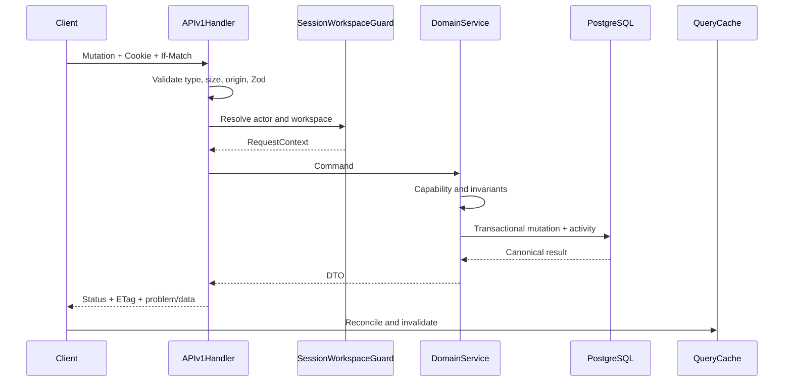

# Fitara Work API contract

- Status: Proposed
- Base path: `/api/v1`
- Authentication: Better Auth database session cookie
- Media type: `application/json`

Better Auth owns `/api/auth/*`; it is intentionally outside `/api/v1`. Route Handlers are transport adapters and call the same domain services used by Server Components and Server Actions.

## 1. Conventions

### Success envelope

```json
{
  "data": {},
  "meta": {
    "requestId": "req_01..."
  }
}
```

Collections add:

```json
{
  "data": [],
  "page": {
    "nextCursor": null,
    "hasMore": false
  },
  "meta": {
    "requestId": "req_01...",
    "resultCount": 0
  }
}
```

### Problem response

Use `application/problem+json` following RFC 9457:

```json
{
  "type": "https://fitara.internal/problems/version-conflict",
  "title": "Ticket version conflict",
  "status": 409,
  "detail": "This ticket changed since it was loaded.",
  "instance": "/api/v1/workspaces/8.../tickets/a...",
  "code": "TICKET_VERSION_CONFLICT",
  "requestId": "req_01...",
  "errors": {
    "title": ["Title must contain at least one character."]
  },
  "current": {
    "version": 8
  }
}
```

Unknown errors never expose stack traces, SQL, OAuth responses, table names, cookies, tokens, or raw provider messages.

### DTO rules

- IDs are opaque strings.
- Dates/times are ISO 8601 UTC; due dates are `YYYY-MM-DD`.
- Responses expose only fields required by the client.
- Drizzle rows are never serialized directly.
- Actor, workspace, reporter, author, sequence, rank, counts, audit timestamps, and activity changes are server-owned.
- Unknown request body fields are rejected.

## 2. Ticket representations

Ticket summary:

```json
{
  "id": "uuid",
  "identifier": "FIT-153",
  "project": { "id": "uuid", "key": "FIT", "name": "Fitara Work" },
  "title": "Prevent duplicate ticket ranks",
  "type": { "id": "uuid", "key": "bug", "name": "Bug" },
  "priority": "p1",
  "status": { "id": "uuid", "key": "in_progress", "name": "In Progress" },
  "assignee": { "membershipId": "uuid", "name": "Sean", "avatarUrl": null },
  "labels": [{ "id": "uuid", "name": "backend", "colorToken": "blue" }],
  "blocked": true,
  "commentCount": 3,
  "dueDate": "2026-10-01",
  "version": 7,
  "archivedAt": null,
  "updatedAt": "2026-09-25T01:00:00.000Z"
}
```

Ticket detail adds description, reporter, criteria, parent, subtasks, relations, attachments (later), and capability flags. Comments and activity are separately paginated.

## 3. Endpoint matrix

### Current user and workspaces

- `GET /api/v1/me` — user, memberships, active workspace preference.
- `GET /api/v1/session` — safe session metadata, absolute/idle expiry, and reauthentication age.
- `GET /api/v1/workspaces` — accessible workspaces.
- `GET /api/v1/workspaces/:workspaceId` — workspace detail.
- `PATCH /api/v1/workspaces/:workspaceId` — workspace settings.
- `POST /api/v1/workspaces/:workspaceId/archive`
- `POST /api/v1/workspaces/:workspaceId/restore`

### Membership and invitations

- `GET /api/v1/workspaces/:workspaceId/memberships`
- `POST /api/v1/workspaces/:workspaceId/invitations`
- `POST /api/v1/workspaces/:workspaceId/invitations/:invitationId/revoke`
- `GET /api/v1/invitations/:token` — safe pre-OAuth invitation summary; token is never logged.
- OAuth callback invokes `acceptWorkspaceInvitation`; acceptance is not a client-authoritative endpoint.
- `PATCH /api/v1/workspaces/:workspaceId/memberships/:membershipId`
- `DELETE /api/v1/workspaces/:workspaceId/memberships/:membershipId`

Membership patches explicitly allow `role` or `state`; they do not accept arbitrary user/profile fields.

### Projects

- `GET /api/v1/workspaces/:workspaceId/projects`
- `POST /api/v1/workspaces/:workspaceId/projects`
- `GET /api/v1/workspaces/:workspaceId/projects/:projectId`
- `PATCH /api/v1/workspaces/:workspaceId/projects/:projectId`
- `POST /api/v1/workspaces/:workspaceId/projects/:projectId/archive`
- `POST /api/v1/workspaces/:workspaceId/projects/:projectId/restore`

There is no MVP project-delete endpoint. Future purge is a separate retention workflow, not overloaded onto `DELETE`.

### Sidebar pins

- `GET /api/v1/workspaces/:workspaceId/sidebar-pins`
- `POST /api/v1/workspaces/:workspaceId/sidebar-pins`
- `PATCH /api/v1/workspaces/:workspaceId/sidebar-pins/:pinId`
- `DELETE /api/v1/workspaces/:workspaceId/sidebar-pins/:pinId`

Create accepts one target:

```json
{ "target": { "type": "project", "id": "uuid" }, "afterPinId": null }
```

Reorder accepts neighboring pin IDs. A user can mutate only their own pins.

### Reference data

- `GET /api/v1/workspaces/:workspaceId/workflows`
- `GET /api/v1/workspaces/:workspaceId/workflows/:workflowId/statuses`
- `GET /api/v1/workspaces/:workspaceId/ticket-types`
- `GET /api/v1/workspaces/:workspaceId/labels`
- `POST /api/v1/workspaces/:workspaceId/labels`
- `PATCH /api/v1/workspaces/:workspaceId/labels/:labelId`
- `POST /api/v1/workspaces/:workspaceId/labels/:labelId/archive`

Workflow and ticket-type mutations are deferred even though these resources are tables.

### Tickets

- `GET /api/v1/workspaces/:workspaceId/tickets`
- `POST /api/v1/workspaces/:workspaceId/tickets`
- `GET /api/v1/workspaces/:workspaceId/tickets/:ticketId`
- `PATCH /api/v1/workspaces/:workspaceId/tickets/:ticketId`
- `POST /api/v1/workspaces/:workspaceId/tickets/:ticketId/move`
- `PUT /api/v1/workspaces/:workspaceId/tickets/:ticketId/assignee`
- `DELETE /api/v1/workspaces/:workspaceId/tickets/:ticketId/assignee`
- `POST /api/v1/workspaces/:workspaceId/tickets/:ticketId/archive`
- `POST /api/v1/workspaces/:workspaceId/tickets/:ticketId/restore`
- `POST /api/v1/workspaces/:workspaceId/tickets/:ticketId/labels/:labelId`
- `DELETE /api/v1/workspaces/:workspaceId/tickets/:ticketId/labels/:labelId`
- `GET /api/v1/workspaces/:workspaceId/tickets/:ticketId/subtasks`
- `GET /api/v1/workspaces/:workspaceId/tickets/:ticketId/activity`

Ticket query parameters:

- `projectId` (repeatable where cross-project views allow it)
- `status` (repeatable)
- `priority` (repeatable)
- `type` (repeatable)
- `labelId` (repeatable)
- `assignee=membershipId|me|unassigned`
- `reporter=membershipId|me`
- `onlyMine=true|false`
- `blocked=true|false`
- `search`
- `includeArchived`
- `view=board|list`
- `sort`
- `cursor`
- `limit` (default 50, max 100)

### Acceptance criteria

- `POST /api/v1/workspaces/:workspaceId/tickets/:ticketId/criteria`
- `PATCH /api/v1/workspaces/:workspaceId/tickets/:ticketId/criteria/:criterionId`
- `DELETE /api/v1/workspaces/:workspaceId/tickets/:ticketId/criteria/:criterionId`

### Comments

- `GET /api/v1/workspaces/:workspaceId/tickets/:ticketId/comments`
- `POST /api/v1/workspaces/:workspaceId/tickets/:ticketId/comments`
- `PATCH /api/v1/workspaces/:workspaceId/tickets/:ticketId/comments/:commentId`
- `DELETE /api/v1/workspaces/:workspaceId/tickets/:ticketId/comments/:commentId`

### Relationships

- `GET /api/v1/workspaces/:workspaceId/tickets/:ticketId/relations`
- `POST /api/v1/workspaces/:workspaceId/tickets/:ticketId/relations`
- `DELETE /api/v1/workspaces/:workspaceId/tickets/:ticketId/relations/:relationId`
- Parent/subtask is changed through ticket patch with `parentTicketId`.

### Saved views

- `GET /api/v1/workspaces/:workspaceId/saved-views`
- `POST /api/v1/workspaces/:workspaceId/saved-views`
- `GET /api/v1/workspaces/:workspaceId/saved-views/:viewId`
- `PATCH /api/v1/workspaces/:workspaceId/saved-views/:viewId`
- `DELETE /api/v1/workspaces/:workspaceId/saved-views/:viewId` (archive semantics)

### Notifications (Phase 8)

- `GET /api/v1/workspaces/:workspaceId/notifications`
- `POST /api/v1/workspaces/:workspaceId/notifications/:notificationId/read`
- `POST /api/v1/workspaces/:workspaceId/notifications/read-all`

Attachments, GitHub, webhooks, and automation endpoints are not advertised until their phases are accepted.

## 4. Mutation contracts

### Create project

```json
{
  "name": "Fitara Work",
  "key": "FIT",
  "description": "Internal work management"
}
```

Creation transaction inserts the project, ticket sequence, default workflow association, and project-created activity where required.

### Create ticket

```json
{
  "projectId": "uuid",
  "title": "Prevent duplicate ticket ranks",
  "description": "Markdown source",
  "ticketTypeId": "uuid",
  "priority": "p2",
  "workflowStatusId": "uuid",
  "assigneeMembershipId": null,
  "labelIds": [],
  "dueDate": null,
  "parentTicketId": null,
  "acceptanceCriteria": [
    { "body": "Concurrent moves produce deterministic results" }
  ]
}
```

The server allocates sequence/rank and creates ticket, assignment, labels, criteria, and activity in one transaction.

### Patch ticket

```json
{
  "title": "Prevent duplicate board ranks",
  "priority": "p1",
  "dueDate": "2026-10-01",
  "parentTicketId": "uuid-or-null"
}
```

Require `If-Match: "7"` and return `ETag: "8"` with the new DTO. Assignment is not accepted here, preventing a member from smuggling reassignment through a general patch.

### Move ticket

```json
{
  "targetStatusId": "uuid",
  "beforeTicketId": "uuid-or-null",
  "afterTicketId": "uuid-or-null"
}
```

Rules:

- Require `If-Match`.
- Neighbor IDs must be adjacent when both are supplied and belong to the target status/project/workspace.
- Server computes rank.
- Status, rank, version, timestamp, and activity commit atomically.

### Assign ticket

```json
{ "membershipId": "uuid" }
```

Owner/admin may assign any active workspace member. Recommended member policy is claim unassigned for self and unassign self only; final policy is a product-owner decision.

### Add relation

```json
{
  "type": "blocks",
  "targetTicketId": "uuid"
}
```

Server canonicalizes symmetric relationships, rejects duplicates/self/cycles, and writes activity.

### Create saved view

```json
{
  "name": "Backend P1 and P2",
  "visibility": "private",
  "definition": {
    "schemaVersion": 1,
    "filters": {
      "priorities": ["p1", "p2"],
      "labels": ["uuid"]
    },
    "sort": [{ "field": "updatedAt", "direction": "desc" }],
    "layout": "list"
  }
}
```

The strict version-1 definition also accepts `viewType: "tickets"`, `visibleFields`, and optional `grouping`; omitted values receive documented defaults. The service `createSavedView` resolves every referenced project, label, status, and assignee through the actor workspace before persistence.

## 5. Validation and normalization

Recommended limits:

- Workspace/project name: 1–100 trimmed characters.
- Workspace slug: 2–63 lowercase slug characters.
- Project key: 2–10 uppercase alphanumeric characters, beginning with a letter.
- Ticket title: 1–200.
- Description: 0–50,000.
- Comment: 1–20,000 after trimming for emptiness.
- Acceptance criterion: 1–1,000.
- Label: 1–50.
- Saved-view name: 1–80.
- Search: 0–200.
- List limit: 1–100.
- Due date: calendar-valid `YYYY-MM-DD`.
- IDs: UUID or exact generated Better Auth ID schema.

Processing order:

1. Enforce content type/body size.
2. Parse path/query/body with strict Zod schemas.
3. Normalize allowed fields.
4. Resolve session and active workspace membership.
5. Load resource through workspace-scoped repository query.
6. Authorize capability and resource-state invariants.
7. Execute transaction.
8. Map explicit DTO.

## 6. Status and error codes

- `200` read/update.
- `201` create.
- `204` successful no-content operation.
- `400` malformed JSON/query/cursor.
- `401` missing/expired session.
- `403` known resource and insufficient capability.
- `404` missing or inaccessible cross-workspace resource.
- `409` version, duplicate, cycle, last-owner, or not-deletable conflict.
- `415` unsupported content type.
- `422` field/domain validation or archived-state failure.
- `428` missing `If-Match`.
- `429` rate limited.
- `500` unexpected safe error.

Stable codes include:

- `AUTHENTICATION_REQUIRED`
- `INSUFFICIENT_PERMISSION`
- `WORKSPACE_NOT_FOUND`
- `TICKET_NOT_FOUND`
- `VALIDATION_FAILED`
- `TICKET_VERSION_CONFLICT`
- `INVALID_STATUS_TRANSITION`
- `ARCHIVED_RESOURCE`
- `ASSIGNMENT_FORBIDDEN`
- `RELATION_CYCLE`
- `LAST_OWNER`
- `PROJECT_NOT_DELETABLE`
- `IDEMPOTENCY_KEY_REUSED`
- `RATE_LIMITED`

## 7. Pagination and result counts

Use opaque keyset cursors:

- Tickets by updated: `(updated_at, id)`.
- Board: `(status_position, rank, id)`.
- Comments: `(created_at, id)`.
- Activity: `(occurred_at, id)`.
- Notifications: `(created_at, id)`.

Cursor content is base64url-encoded and integrity-protected or reconstructed from strictly parsed fields. It is bound to the selected sort. Invalid/mismatched cursors return `400 INVALID_CURSOR`.

Exact result counts are acceptable for MVP datasets. Measure filtered counts; if expensive, move to separate/approximate counts and document the response change.

## 8. Idempotency and concurrency

Require `Idempotency-Key` for ticket, comment, and invitation creation.

- Persist workspace, actor membership, operation, key, canonical request hash, stored response/result reference, creation time, and expiry for 24 hours; uniqueness is `(workspace, actor, operation, key)`.
- Same key/body replays the original result.
- Same key/different body returns `409 IDEMPOTENCY_KEY_REUSED`.
- Idempotency never replaces `If-Match`.

Mutable ticket, project, comment, criterion, saved-view, and sidebar-order resources expose `version` and `ETag`/expected version. Stale writes return `409` with safe current version/DTO information. Project archival, ticket movement, and sidebar reorder identify their service operation in the endpoint matrix; every endpoint is an adapter to the same-named domain operation, not independent business logic.

## 9. Endpoint contract requirements

Every matrix entry inherits: Better Auth database session, active membership, state/capability/resource checks, strict request schema and explicit response DTO, RFC 9457 errors, `private, no-store`, correlation ID, and transactional activity for meaningful mutations. Collection reads use deterministic cursor sorting with `id` as final tie-breaker. Route `workspaceId` is a lookup hint only; the effective workspace comes from the authenticated membership and scoped resource. Suspended/removed membership fails even with a valid session.

## 10. Cache and reconciliation

Authenticated API default:

```http
Cache-Control: private, no-store
Vary: Cookie
```

- No shared CDN caching of workspace data.
- Initial Server Component reads call services directly.
- TanStack Query owns browser server-state caching.
- Query keys include workspace and normalized filters.
- Mutation success reconciles the canonical response and invalidates related board/list/detail/count/activity views.
- Optimistic rollback restores snapshots on network, `403`, `409`, and `422`.
- Project deletion, role changes, ownership, and archival wait for server confirmation.

## 11. CSRF, origin, rate limits, and cookies

- Better Auth handles OAuth state and its auth-route protections.
- All cookie-authenticated unsafe `/api/v1` methods validate same-origin `Origin`/`Host`; reject absent/mismatched origins according to documented browser/client policy.
- CORS is same-origin by default. Future token-authenticated integrations receive a separate authentication design.
- Session cookies are server-set, `HttpOnly`, `Secure` in production, and `SameSite=Lax` unless the auth library's reviewed configuration requires stricter behavior.
- Apply Vercel rate controls plus a distributed store only when limits must be consistent across instances.
- Prioritize auth attempts, invitations, comments, search, deletion, and later uploads/webhooks.
- Return `Retry-After` with `429`.

## 12. Request flow



## 13. Future integration access

Future mobile clients use `/api/v1` with a separately designed OAuth/token scheme. GitHub webhooks live at `/api/webhooks/github`, verify signatures against the raw body, map installation to workspace, deduplicate delivery IDs, enqueue durable work, and return quickly. They call domain services using a scoped machine principal; they do not write repositories directly.
