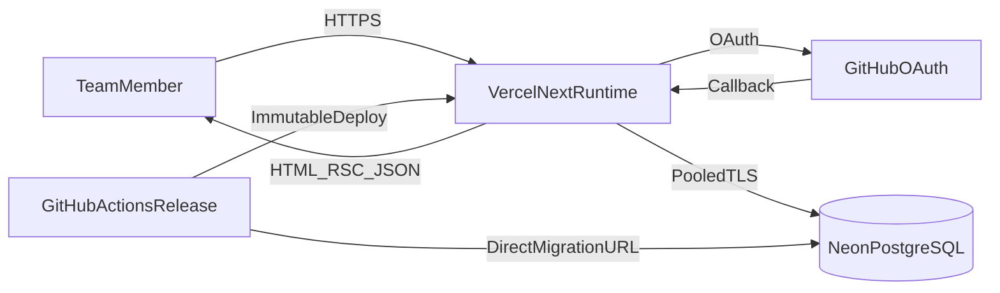
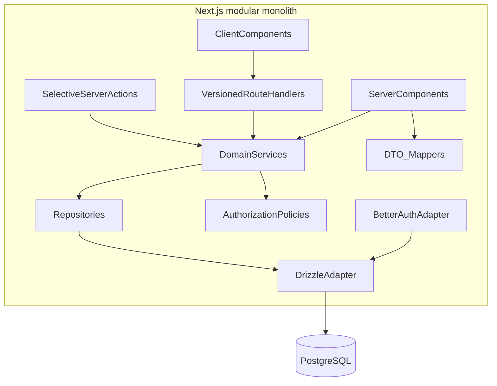
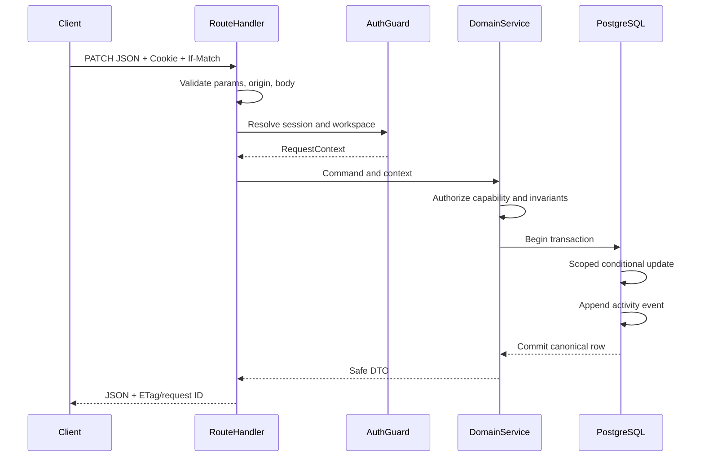
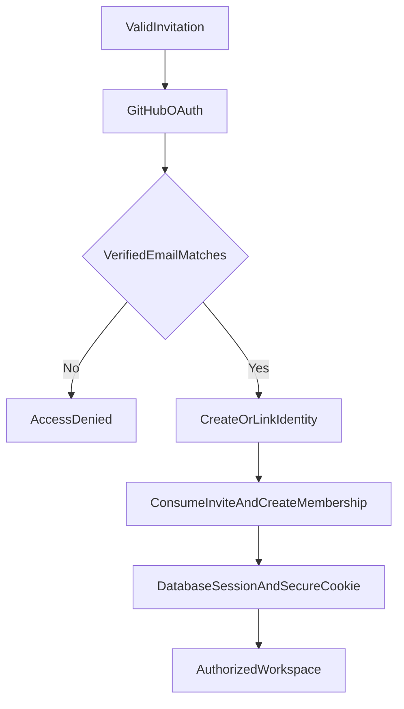

# Fitara Work architecture

- Status: Proposed
- Style: Full-stack modular monolith
- Runtime: Next.js 16 App Router on Vercel
- Database: PostgreSQL on Neon
- Package manager: npm

## 1. Context

The repository is a root-level Next.js 16.3.6 scaffold. It has no `src/` directory, its `@/*` alias maps to the repository root, and `next.config.ts` has no options. The architecture keeps those conventions rather than creating avoidable churn.

### Current repository assessment

- `package.json` has only `next@16.3.6`, `react@19.2.8`, and `react-dom@19.2.8` at runtime.
- Development dependencies are Tailwind/PostCSS 4, TypeScript 5, Node/React type packages, ESLint 9, and `eslint-config-next@16.3.6`.
- Installed resolutions include TypeScript 5.9.3 and Tailwind CSS 4.3.3. `npm ls --depth=0` currently reports seven extraneous optional/WASM helper packages; Phase 0 must verify this through a clean `npm ci` rather than manually deleting them.
- Available scripts are `dev`, `build`, `start`, and `lint`. There is no typecheck, format, test, database, seed, migration, or CI script.
- `tsconfig.json` is strict, no-emit, bundler-resolved, and incremental, but still has `allowJs: true` and `skipLibCheck: true`; `@/*` maps to the repository root.
- ESLint uses the flat config with Next Core Web Vitals and TypeScript rules. There is no formatter configuration.
- Tailwind is imported through `@import "tailwindcss"` in `app/globals.css`; the scaffold has two light/dark variables and an Arial body override despite loading Geist in the root layout.
- Root metadata and `app/page.tsx` are unchanged Create Next App content. `public/` contains only the five scaffold SVGs.
- `.gitignore` ignores all `.env*` files and will need an explicit exception for `.env.example`.
- README lists npm, Yarn, pnpm, and Bun even though npm is the required workflow.
- The current branch is `main`, has no commits, tracks a missing `origin/main`, and all scaffold files are untracked. Documentation changes must be reviewed without resetting that state.
- `npm run lint` passes before and after this documentation work.

The installed Next.js guidance establishes these constraints:

- Pages and layouts are Server Components by default.
- Client Components should be narrow interaction boundaries.
- Route Handlers are public endpoints and are not cached by default.
- Server Actions are public POST surfaces and must independently authenticate and authorize.
- Server Components should call the service/data source directly, not fetch this application's Route Handlers.
- Authorization belongs close to data access; a layout or `proxy.ts` check is not sufficient.
- The current repository does not enable Cache Components, so the design does not assume `use cache`.

## 2. Architecture principles

1. Keep one deployable application until a measured requirement justifies another service.
2. Organize business logic by domain capability.
3. Keep React, HTTP, auth, services, and persistence as explicit boundaries.
4. Use Server Components for authorized initial reads.
5. Use Client Components only for interaction, browser APIs, and optimistic state.
6. Treat every Route Handler and Server Action as a public endpoint.
7. Put business invariants and authorization in reusable services, not adapters.
8. Require workspace context in every workspace-owned repository operation.
9. Select DTO fields explicitly; never expose unrestricted database rows.
10. Use transactions and constraints for durable invariants.
11. Prefer fresh, uncached workspace data until cache isolation is proven.
12. Keep future integrations behind the same services and audit rules.

## 3. System architecture





## 4. Technology decisions

### PostgreSQL and Drizzle ORM

Use PostgreSQL for transactions, foreign keys, partial/compound indexes, JSONB where appropriate, full-text search, row locking, and durable audit history.

Use Drizzle ORM with `drizzle-orm/node-postgres` and `pg` against Neon's pooled PostgreSQL URL in the Vercel Node.js runtime. `node-postgres` supports checked-out connections and multi-statement interactive transactions. Do not substitute an HTTP query mode for transaction-heavy services unless its then-current semantics are separately proved. Release migrations use Drizzle Kit with a direct/unpooled administrative URL; local development and integration tests use distinct PostgreSQL URLs. Use this driver for:

- Type-safe schema and queries without hiding SQL.
- Checked-in generated SQL migrations.
- Explicit selects and joins.
- Fine control over atomic sequence updates, version predicates, indexes, and constraints.

Prisma is a valid alternative, but Drizzle better fits the required SQL-level constraints and reduces runtime/generator complexity in a Vercel/Neon deployment. Raw SQL remains permitted inside the repository layer for capabilities Drizzle cannot express clearly.

### Better Auth and GitHub OAuth

Use Better Auth with:

- GitHub OAuth.
- Database sessions.
- Separate development and production OAuth applications.
- Invite/allowlist enforcement owned by the application.
- Secure server cookies and explicit trusted origins.

Authentication answers who the user is. Workspace membership and roles remain Fitara Work domain concerns.

### Zod

Use strict Zod schemas for environment values, route params, query strings, request bodies, forms, saved-view JSON, integration payloads, and selected response contracts. Zod validation does not replace authorization, transactions, or database constraints.

### Interaction and server state

- Server Components load initial authorized data directly through services.
- URL search parameters own shareable board/list filters.
- TanStack Query owns interactive client-side server state and mutation reconciliation.
- React state owns ephemeral UI state such as open menus, local drafts, drag state, and selection.
- React `useOptimistic` may be used for isolated form experiences; TanStack Query snapshots own cross-view ticket/pin updates.
- No Redux/Zustand global store is required for MVP.

### Drag and drop

Use `@dnd-kit/core` and sortable utilities in a narrow client boundary. Configure pointer and keyboard sensors, screen-reader announcements, focus restoration, and a non-drag move menu. The server computes rank from neighbors; the browser never owns canonical rank.

### Component strategy

- Tailwind CSS 4 and CSS custom properties define tokens.
- Repository-owned components compose accessible native controls and selected Radix primitives where focus/overlay behavior is complex.
- Avoid installing an entire component framework.
- Keep visual variants typed and central.
- Use Lucide or similarly focused icon package only if approved in Phase 0.

### Testing

- Vitest for pure domain, schema, utility, service, and synchronous component tests.
- React Testing Library and user-event for Client Component behavior.
- PostgreSQL integration tests against an isolated database.
- Playwright for async Server Component routes and critical journeys.
- Accessibility checks with semantic assertions, keyboard E2E, and an approved axe integration.

## 5. Proposed repository structure

```text
app/
  (auth)/
    sign-in/page.tsx
    invite/[token]/page.tsx
    auth/error/page.tsx
  (workspace)/
    w/[workspaceSlug]/
      layout.tsx
      my-work/page.tsx
      triage/page.tsx
      active/page.tsx
      projects/page.tsx
      projects/new/page.tsx
      projects/[projectKey]/page.tsx
      projects/[projectKey]/tickets/page.tsx
      tickets/[ticketIdentifier]/page.tsx
      settings/{profile,members,projects,workspace}/page.tsx
  api/
    auth/[...all]/route.ts
    v1/workspaces/[workspaceId]/...
    health/route.ts
  layout.tsx
  page.tsx
  globals.css
  global-error.tsx
components/
  app-shell/
  feedback/
  ui/
features/
  projects/
  sidebar/
  tickets/
    board/
    detail/
    filters/
    forms/
  comments/
  activity/
server/
  auth/
  authorization/
  workspaces/
  projects/
  tickets/
  comments/
  activity/
  saved-views/
  notifications/
  shared/
db/
  client.ts
  schema/
  migrations/
  seed/
lib/
  env.ts
  errors.ts
  logger.ts
  http.ts
  query-client.ts
tests/
  factories/
  fixtures/
  integration/
e2e/
```

Each server domain typically contains `service.ts`, `repository.ts`, `policy.ts`, `schemas.ts`, and `dto.ts`. Small domains should not be split mechanically; add a repository abstraction only where it protects scope, query complexity, or testability.

## 6. Dependency rules

Allowed:

- `app` adapters import services and DTOs.
- Feature Client Components import client-safe schemas, DTO types, and query adapters.
- Services import policies, repositories, and domain helpers.
- Repositories import Drizzle and database schema.

Forbidden:

- Client Components importing `server/`, `db/`, auth secrets, or server environment.
- Components issuing database queries.
- Server Components making HTTP calls to this application's API.
- Route Handlers duplicating domain rules.
- One domain reaching through another domain's repository instead of its service.
- Repository methods such as `findTicket(id)` without workspace scope.

Import `server-only` from database, auth, repository, secret, and service entry points.

## 7. Component hierarchy

```text
RootLayout
└── ThemeProvider (small client provider)
    ├── PublicRoutes
    └── WorkspaceRoute
        ├── AppShell
        │   ├── WorkspaceSwitcher
        │   ├── PrimaryNavigation
        │   ├── PinnedWork
        │   └── UserMenu
        └── WorkspacePage
            ├── WorkspaceHeader
            │   ├── Breadcrumbs
            │   ├── ViewSwitcher
            │   └── NewTicketButton
            ├── TicketToolbar
            ├── ResultSummary
            ├── BoardOrList (client island)
            │   ├── TicketBoard
            │   │   └── StatusColumn
            │   │       └── TicketCard
            │   └── TicketTable
            └── TicketDrawer (parallel/intercepted route)
                └── TicketDetail
                    ├── TicketFields
                    ├── AcceptanceCriteria
                    ├── Relationships
                    ├── Comments
                    └── ActivityTimeline
```

The shell, headers, and initial summaries remain Server Components. Board interaction, filters with immediate feedback, drawer focus management, forms, menus, and mutation feedback are Client Components.

## 8. Backend module hierarchy

```text
Transport adapter
  -> strict input parser
  -> session resolver
  -> workspace context resolver
  -> domain service
       -> capability policy
       -> domain invariants
       -> scoped repository transaction
       -> activity event
  -> DTO mapper
  -> response/error adapter
```

Services accept an explicit actor/context:

```ts
type RequestContext = {
  requestId: string;
  userId: string;
  workspaceId: string;
  membershipId: string;
  role: "owner" | "admin" | "member" | "viewer";
};
```

Future GitHub or automation callers use an explicit machine principal and capability set. They do not bypass services.

## 9. Request processing



## 10. Server Components, Route Handlers, and Server Actions

### Server Components

Use for:

- Session-aware shell composition.
- Initial project, board, list, and ticket reads.
- Permission-sensitive rendering.
- Search parameter parsing.
- Streaming independent regions.

Call services directly. Wrap repeated session/context resolution in React `cache()` for request-local memoization only.

### Route Handlers

Use `/api/v1` as the canonical API for:

- Client-side board/list reads after initial render.
- Ticket and pin mutations.
- Future mobile and integration clients.
- Webhooks and machine callbacks in dedicated namespaces.

Handlers own HTTP concerns and call services. Auth remains at `/api/auth/[...all]` because Better Auth owns that contract.

### Server Actions

Use selectively for progressively enhanced, navigation-oriented forms such as project creation, invitation, and settings changes. They call the same service as Route Handlers and repeat authentication, authorization, and validation.

Do not use Server Actions for reads, frequent drag operations, or parallel fetching. Their client dispatch is sequential.

## 11. Authentication and session flow



- OAuth uses state/PKCE capabilities provided by the library/provider.
- Session records are in PostgreSQL; cookies carry opaque session material.
- Production cookies are `HttpOnly`, `Secure`, `SameSite=Lax` unless Better Auth requires stricter documented behavior, and scoped to the application.
- Session expiry, suspension, and membership checks happen near protected data.
- `proxy.ts` may perform an optimistic cookie redirect but never replaces the database check.

Admission uses exact verified-email matching for MVP. Normalize by trimming and Unicode-safe lowercasing; do not apply provider-specific dot or plus rewriting. After OAuth, require a GitHub email marked verified, then transactionally lock a pending, unexpired `WorkspaceInvitation`, create/link the user under Better Auth's supported hook, create or restore membership, mark the invitation accepted, and append `workspace.invitation.accepted`. Establish the session only after commit. Existing users still need an active membership for the requested workspace. Public workspace creation is disabled.

Bootstrap the first owner through a one-time audited administrative CLI/service operation using a normalized verified email and explicit workspace identifier. It uses an administrative credential, refuses ambiguous or already-owned workspaces, and is never exposed through OAuth or the public API.

Sessions have a 12-hour absolute lifetime and 30-minute rolling idle timeout. Require authentication within the previous 15 minutes for ownership transfer, workspace archival, membership removal, and integration-secret changes. Keep Better Auth's cookie session cache disabled for MVP. Every protected request resolves the database session; important mutations reload membership state and role. Account suspension or membership suspension/removal revokes affected sessions before success returns. Cookies are opaque, host-only, `HttpOnly`, `Secure` in production, `SameSite=Lax`; production is HTTPS-only.

## 12. Workspace isolation and authorization

Use six layers:

1. Resolve the Better Auth session.
2. Resolve an active membership for the route workspace.
3. Pass immutable workspace context through services.
4. Check membership state and named capability.
5. Check resource ownership/project lifecycle and mutation-specific invariants.
6. Require `workspaceId` in every repository predicate and composite relationship.

The route workspace is only a lookup hint. Effective scope comes from the authenticated membership and scoped resource; never trust a body/query `workspaceId`. Repository methods accept `RequestContext` plus resource IDs, not naked IDs, and return not-found for cross-workspace references.

Workspace-owned tables include `workspace_id` even when it could be inferred. Composite uniqueness/foreign keys prevent cross-workspace labels, statuses, assignees, parents, and relations.

PostgreSQL row-level security is deferred until transaction-local context and Neon pooled-connection behavior are proven in tests. The MVP security contract does not depend on unimplemented RLS.

## 13. Data fetching and cache strategy

### Server

- Authenticated Route Handler responses default to `Cache-Control: private, no-store`.
- Do not use shared Next.js caching for workspace data in MVP.
- Use React `cache()` only to deduplicate within one render request.
- Stream fresh data behind meaningful `Suspense` boundaries.
- If Cache Components are later enabled, create a separate ADR before using `use cache`.

### Client

TanStack Query keys begin with the workspace:

```text
["workspaces", workspaceId, "projects"]
["workspaces", workspaceId, "tickets", normalizedFilters]
["workspaces", workspaceId, "ticket", ticketId]
["workspaces", workspaceId, "ticket", ticketId, "comments"]
["workspaces", workspaceId, "my-work", normalizedFilters]
```

Recommended starting defaults:

- Board/detail `staleTime`: 15–30 seconds.
- `gcTime`: 5 minutes.
- Refetch active work on focus.
- Conservative read retries.
- No automatic retry for non-idempotent mutations.

After mutation, reconcile with the canonical response and invalidate affected board/list/detail/count/activity queries. Use `router.refresh()` only when server-rendered shell or count data must change.

## 14. Optimistic updates

Appropriate:

- Ticket status/rank.
- Personal pin add/remove/reorder.
- Comment creation with a temporary client ID.
- Acceptance criterion completion.

Wait for confirmation:

- Role changes.
- Project archival/deletion.
- Ownership transfer.
- Integration installation.

Mutation algorithm:

1. Cancel affected query refetches.
2. Snapshot only affected cache entries.
3. Apply a pending optimistic representation.
4. Send idempotency key where applicable and `If-Match`/expected version.
5. On success, replace with server DTO and invalidate related views.
6. On failure, restore the snapshot and announce the error.
7. On conflict, show current server state while preserving intended input.

## 15. Concurrency

- Ticket creation atomically updates a per-project `TicketSequence` row and inserts ticket/activity in one transaction.
- Mutable resources carry an integer `version`.
- Updates use `WHERE workspace_id = ? AND id = ? AND version = ?`, then increment.
- `If-Match` is required for updates where lost writes matter; missing preconditions return `428`.
- Board and sidebar order use fixed-width 16-character uppercase hexadecimal ranks representing unsigned 64-bit integers, ordered lexicographically, with stable `id` tie-breaker. Initial/end ranks use gaps of `2^32`; between neighbors uses the integer midpoint. A gap of one, collision, or value within `2^20` of a bound triggers a locked rebalance assigning `2^32, 2*2^32, ...` in current `(rank,id)` order. Status and rank change together. A competing move loses through the ticket version predicate and returns `409`; serialization/deadlock failures retry at most twice with jitter. Archived tickets do not occupy active order, and filtered views never define canonical neighbors.
- Deadlocks/serialization failures may be retried a small bounded number of times inside the service.

## 16. Errors and logging

Typed application errors:

- `UnauthenticatedError`
- `ForbiddenError`
- `NotFoundError`
- `ValidationError`
- `ConflictError`
- `PreconditionRequiredError`
- `RateLimitError`

Adapters map them to RFC 9457-style problem responses, action state, or page behavior. Unknown errors receive a request ID, structured server log, and generic client response.

Use a server-only structured logger (Pino or a minimal compatible wrapper) with redaction. Include request ID, route template, duration, status, safe user/workspace IDs, deployment, and error code. Exclude secrets and user-authored bodies.

## 17. Security controls

- Strict input schemas and explicit update objects prevent mass assignment.
- Origin/CSRF checks protect cookie-authenticated unsafe methods.
- Same-origin by default; no broad CORS.
- Vercel platform limits and application limits protect auth, invitations, search, comments, and destructive routes.
- Apply security headers and a deliberate Content Security Policy after inventorying OAuth and assets.
- Sanitize Markdown output; do not store rendered HTML as source of truth.
- Validate payload content type and size before parsing.
- Use database constraints as the final invariant layer.
- Rotate and scope environment secrets by environment.
- Use Node runtime for database/auth routes unless an edge-safe path is explicitly proven.

## 18. Environment validation

`lib/env.ts` parses server values once and fails fast:

```text
DATABASE_URL
DATABASE_URL_UNPOOLED
BETTER_AUTH_SECRET
BETTER_AUTH_URL
GITHUB_CLIENT_ID
GITHUB_CLIENT_SECRET
NEXT_PUBLIC_APP_URL
LOG_LEVEL
```

Optional providers add their variables only when selected. Client code receives only explicitly validated `NEXT_PUBLIC_*` values.

## 19. Future GitHub integration

Login OAuth and repository integration are separate.

Future repository integration uses:

- A least-privilege GitHub App.
- Encrypted installation credential references.
- Workspace/project repository links by stable GitHub node ID.
- Signature-verified webhooks.
- Unique delivery IDs for idempotency.
- Fast webhook receipt followed by durable asynchronous processing.
- Normalized `GitHubDevelopmentEvent` records linked to tickets by explicit references.
- Provider adapters that call the same domain services with a machine principal.

GitHub outages must not block manual ticket work.

## 20. Future automation boundary

Automation is an event consumer, not table-triggered hidden behavior:

- Domain mutation writes activity and a separate transactional outbox event.
- Worker evaluates versioned, validated trigger/condition/action definitions.
- Actions invoke domain services with an automation principal.
- Execution records actor, rule version, source event, idempotency key, result, and error.
- Quotas, recursion depth, loop detection, dry-run, kill switch, and retry policy are mandatory.

Activity history is an audit record; it is not itself used as a mutable job queue.

## 21. Deployment architecture

- Vercel hosts the Next.js Node runtime.
- Neon provides isolated local/preview/staging/production databases or branches.
- Runtime uses the pooled TLS URL.
- Controlled migration jobs use the direct/unpooled URL where required.
- GitHub Actions runs CI and, subject to owner approval, orchestrates production build → migrate → deploy → smoke.
- Application startup and Vercel builds never run production migrations.

## 22. Architecture risks

- Better Auth schema identifier types must be generated before finalizing foreign keys.
- Invite-only policy is not guaranteed merely by enabling GitHub OAuth.
- Two caches can diverge; DTOs and query invalidation must be centralized.
- Project key edits would destabilize identifiers; keys become immutable after first ticket.
- Authorization can drift if adapters bypass services; route/service test matrices are required.
- Serverless pooling can exhaust connections if clients are created per request incorrectly.
- Activity metadata can leak sensitive values unless action-specific allowlists are used.
- Rank density and rebalance frequency require monitoring and concurrency tests.

## 23. Product-owner decision register

Recommended MVP defaults are: exact verified-email invitations; the session policy in section 11; members self-claim/unassign only; 15-minute author comment edits; workspace-visible projects; project archive/restore by owner/admin; in-app notifications for assignment, mention, blocking, and comments on assigned/reported work; audited administrative first-owner bootstrap; no routine purge until retention is approved; target RPO 15 minutes/RTO 4 hours subject to Neon plan; same-region Neon/Vercel chosen before launch; no staging until production readiness unless required; structured Vercel logs plus an owner-selected error provider; and owner-designated release managers. Commercial/provider choices remain unresolved in the product specification and deployment plan.
# Phase 2 authentication and interaction

Better Auth is integrated through `/api/auth/[...all]` with the existing Drizzle user model plus credential accounts, sessions, and verification records. Public signup and email login routes are disabled. A server-only account-creation instance is callable only behind workspace authorization; it is never mounted as a public route. Session resolution produces an `ActorContext` from the current database membership and services enforce capabilities. The former seeded-owner resolver has been removed.

The board uses the current Dnd Kit React adapter. A drop sends stable neighbor intent and an expected version. The repository locks the affected rows, validates workspace/status membership, normalizes integer positions, increments the moved ticket version, and appends activity in one transaction.
