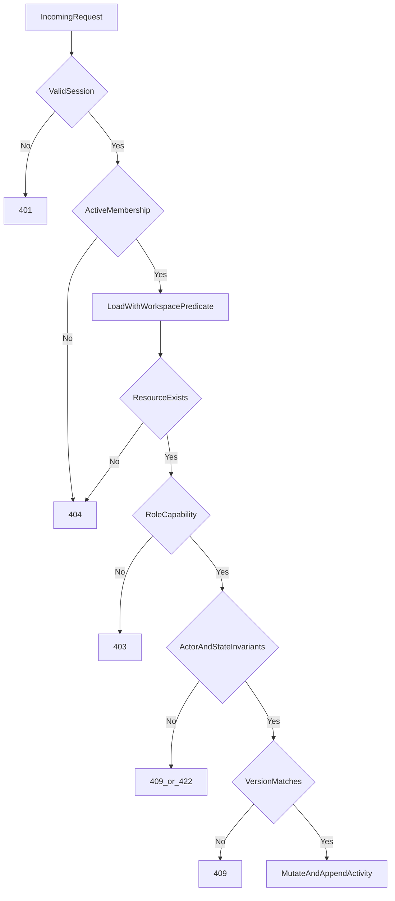

# Fitara Work authorization matrix

- Status: Proposed
- Model: Workspace-scoped RBAC plus resource and state invariants

## 1. Roles

- **Owner:** workspace custody, ownership transfer, destructive administration, and all operational capabilities.
- **Admin:** membership/project/ticket administration without ownership transfer or exceptional destructive custody.
- **Member:** ordinary ticket work and collaboration.
- **Viewer:** read-only shared domain access plus personal sidebar/saved-view preferences.

Every decision requires:

1. Valid Better Auth database session.
2. Active workspace membership.
3. Resource loaded through a `workspace_id` predicate.
4. Role capability.
5. Resource-state and actor-specific invariants.
6. Version precondition where required.

UI visibility is convenience only. Service policy is authoritative.

Legend: `Allow`, `Conditional`, `Deny`. Unauthenticated, authenticated-without-membership, suspended, and removed actors are denied every workspace operation. Unauthenticated requests receive `401`; all other inactive/nonmember cases receive non-enumerating `404` except account/session administration.

## 2. Workspace and membership

| Action | Owner | Admin | Member | Viewer |
|---|---|---|---|---|
| Read workspace and member directory | Allow | Allow | Allow | Allow |
| Edit workspace identity/settings | Allow | Allow | Deny | Deny |
| Create another workspace through product UI/API | Deny | Deny | Deny | Deny |
| Archive/restore workspace | Allow | Deny | Deny | Deny |
| Transfer ownership | Allow | Deny | Deny | Deny |
| Invite owner/admin | Allow | Deny | Deny | Deny |
| Invite member/viewer | Allow | Allow | Deny | Deny |
| Change owner/admin role | Allow | Deny | Deny | Deny |
| Change member/viewer role | Allow | Allow | Deny | Deny |
| Suspend/remove non-owner | Allow | Conditional | Deny | Deny |
| Suspend/remove owner | Conditional | Deny | Deny | Deny |
| Leave workspace | Conditional | Allow | Allow | Allow |

Conditions:

- No operation leaves zero active owners.
- Admin cannot change, suspend, or remove an owner or another admin.
- A user cannot elevate their own role.
- Ownership transfer and old-owner role change occur in one transaction.
- Workspace creation policy requires product-owner approval.

## 3. Projects and configuration

| Action | Owner | Admin | Member | Viewer |
|---|---|---|---|---|
| List/read active or authorized archived projects | Allow | Allow | Allow | Allow |
| Create/edit project | Allow | Allow | Deny | Deny |
| Archive/restore project | Allow | Allow | Deny | Deny |
| Request future controlled purge | Conditional | Deny | Deny | Deny |
| Manage workflow/status definitions | Allow | Allow | Deny | Deny |
| Manage ticket types | Allow | Allow | Deny | Deny |
| Create/edit labels | Allow | Allow | Allow | Deny |
| Archive label | Allow | Allow | Conditional | Deny |

Future purge is outside MVP and requires an approved retention process, elevated owner authority, explicit confirmation, audit evidence, and backup impact review. No routine project hard-delete endpoint exists.

A member may archive only an unused label they created. This narrower policy can be simplified to admin-only if product prefers.

## 4. Tickets and relationships

| Action | Owner | Admin | Member | Viewer |
|---|---|---|---|---|
| List/read tickets and activity | Allow | Allow | Allow | Allow |
| Create ticket | Allow | Allow | Allow | Deny |
| Edit title/description/type/priority/due date | Allow | Allow | Allow | Deny |
| Move status/rank | Allow | Allow | Allow | Deny |
| Add/remove labels | Allow | Allow | Allow | Deny |
| Add/edit acceptance criteria | Allow | Allow | Allow | Deny |
| Set/change parent | Allow | Allow | Allow | Deny |
| Add/remove ticket relations | Allow | Allow | Allow | Deny |
| Archive/restore any ticket | Allow | Allow | Deny | Deny |
| Archive own reported ticket | Allow | Allow | Conditional | Deny |
| Hard-delete ticket | Deny | Deny | Deny | Deny |

Member archival, if approved, requires that the member reported the ticket, it has no active subtasks, and it is not blocking active work. Archived projects/tickets are read-only except for authorized restore.

## 5. Assignment protection

| Action | Owner | Admin | Member | Viewer |
|---|---|---|---|---|
| Assign any active workspace member | Allow | Allow | Deny | Deny |
| Claim an unassigned ticket for self | Allow | Allow | Conditional | Deny |
| Unassign self | Allow | Allow | Conditional | Deny |
| Replace/unassign another assignee | Allow | Allow | Deny | Deny |
| Assign suspended or cross-workspace user | Deny | Deny | Deny | Deny |

Recommended member default is self-claim/self-unassign only. Assignment rules:

- Target membership is resolved under the same workspace and must be active.
- General ticket patch does not accept `assigneeMembershipId`; assignment uses a dedicated service.
- A member cannot take work currently assigned to someone else.
- Every assignment uses `If-Match` and records old/new membership IDs in activity.
- Unauthorized reassignment returns `403`; stale assignment returns `409`.

## 6. Comments, saved views, pins, and notifications

| Action | Owner | Admin | Member | Viewer |
|---|---|---|---|---|
| Read comments/activity | Allow | Allow | Allow | Allow |
| Add comment | Allow | Allow | Allow | Deny |
| Edit/redact own comment | Conditional | Conditional | Conditional | Deny |
| Moderate another comment | Allow | Allow | Deny | Deny |
| Create private saved view | Allow | Allow | Allow | Allow |
| Create workspace-shared saved view | Allow | Allow | Allow | Deny |
| Edit/archive own saved view | Allow | Allow | Allow | Allow |
| Edit another shared view | Allow | Allow | Deny | Deny |
| Pin/unpin/reorder own sidebar | Allow | Allow | Allow | Allow |
| Mutate another user's sidebar | Deny | Deny | Deny | Deny |
| Read/mark own notifications | Allow | Allow | Allow | Allow |
| Read another user's notifications | Deny | Deny | Deny | Deny |

Viewer preferences affect only personal data and do not mutate projects/tickets.

Own-comment edits are allowed only within 15 minutes and with the expected version. Owner/admin moderation is allowed afterward, produces a tombstone rather than erasure, and writes revision plus activity evidence.

## 7. Integrations and automation (later)

| Action | Owner | Admin | Member | Viewer |
|---|---|---|---|---|
| View integration status/development links | Allow | Allow | Allow | Allow |
| Install/remove integration | Allow | Deny | Deny | Deny |
| Configure project repository links | Allow | Allow | Deny | Deny |
| Manage automation rules | Allow | Allow | Deny | Deny |
| View automation execution history | Allow | Allow | Allow | Deny |

GitHub webhooks authenticate as a scoped integration principal. Automations execute as an explicit automation principal. Neither inherits owner capabilities.

## 8. Response behavior

| Condition | Response |
|---|---|
| Missing/invalid session | `401` |
| No active membership for route workspace | `404` |
| Resource belongs to another workspace | `404` |
| Known in-workspace operation is disallowed | `403` |
| Resource state/invariant disallows mutation | `409` or `422` |
| Version does not match | `409` |
| `If-Match` required but absent | `428` |

Cross-workspace objects use `404` to avoid confirming existence.

## 9. Authorization flow



## 10. Policy implementation

Use named capabilities rather than scattered role comparisons:

```ts
type Capability =
  | "workspace:update"
  | "workspace:transfer"
  | "membership:manage"
  | "project:create"
  | "project:archive"
  | "project:request-purge"
  | "ticket:create"
  | "ticket:update"
  | "ticket:move"
  | "ticket:assign-any"
  | "ticket:claim-self"
  | "ticket:archive-any"
  | "comment:moderate"
  | "integration:manage";
```

Policy receives actor, capability, and resource facts. Repository access still requires workspace scope after policy approval.

## 11. Authorization test strategy

### Parameterized role tests

```ts
describe.each([
  ["owner", "project:create", true],
  ["admin", "project:create", true],
  ["member", "project:create", false],
  ["viewer", "project:create", false],
  ["owner", "project:request-purge", false],
  ["admin", "project:request-purge", false],
  ["member", "ticket:move", true],
  ["viewer", "ticket:move", false],
] as const)("%s / %s", (role, capability, expected) => {
  it("enforces the matrix", () => {
    expect(can(role, capability)).toBe(expected);
  });
});
```

### Required integration scenarios

- Every role against every mutating endpoint.
- Same resource ID through another workspace returns `404`.
- Suspended membership is denied despite valid session.
- Viewer changes only their own pins/private views.
- Member cannot modify another author's comment.
- Admin cannot demote/remove owner or another admin.
- Last owner cannot leave, be suspended, or be demoted.
- Ownership transfer is atomic.
- No application route/service performs project hard deletion.
- Concurrent owner changes lock and re-count active owners; exactly one conflicting operation may succeed without reaching zero.
- Valid session with removed membership and cached former role is denied; affected sessions are revoked.
- Member cannot smuggle assignee, reporter, actor, role, workspace, rank, or version through a general patch.
- Archived project rejects ticket creation.
- Failed mutation creates no activity event.
- Successful meaningful mutation creates exactly one expected event.
- Activity `UPDATE`/`DELETE` fails at the database boundary.
- Stale move/assignment returns `409` without overwrite.
- Cross-workspace parent, label, status, type, relation, assignee, and saved-view IDs are rejected.
- Integration/automation principals cannot call owner-only services.
- API, Server Action, and Server Component entry points produce the same policy result.
# Phase 2 capability matrix

| Capability | Owner | Admin | Member | Viewer |
| --- | --- | --- | --- | --- |
| Read workspace work | Yes | Yes | Yes | Yes |
| Create/edit/assign/move tickets | Yes | Yes | Yes | No |
| Create/update/archive projects | Yes | Yes | No | No |
| Create accounts | Any role | Member/viewer | No | No |
| Manage memberships | Yes | Member/viewer only | No | No |
| Manage workspace settings | Yes | No | No | No |

The service layer is authoritative. Admins cannot manage owners or promote users above viewer/member. Owners cannot demote or suspend the final active owner; affected owner rows are locked before this invariant is checked.
