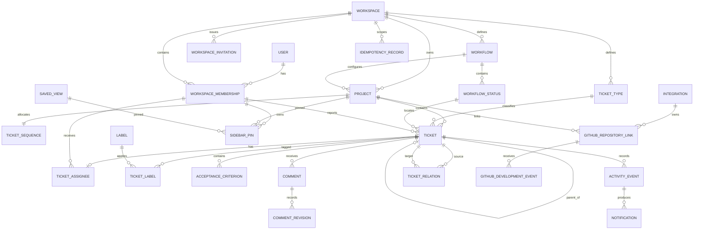

# Fitara Work data model

- Status: Proposed
- Store: PostgreSQL on Neon
- Mapping: Drizzle ORM with checked-in SQL migrations
- Conventions: database `snake_case`, TypeScript `camelCase`, UTC `timestamptz`

## 1. Modeling principles

- Use UUIDs for domain primary keys. Match Better Auth's generated identifier type for foreign keys to auth-owned records.
- Put `workspace_id` on every workspace-owned row and include it in repository predicates.
- Use composite uniqueness/foreign keys where they prevent cross-workspace references.
- Archive ordinary records; do not hard-delete by default.
- Use tables for configurable domain concepts, enums/constrained text for fixed security semantics, and versioned JSONB only for flexible configuration/event payloads.
- Allocate ticket numbers and write activity inside the same transaction as the ticket mutation.
- Use integer `version` fields for optimistic concurrency.
- Select client DTO fields explicitly.

## 2. Shared field conventions

Mutable domain records generally include:

- `id uuid primary key default gen_random_uuid()`
- `workspace_id uuid not null`
- `created_at timestamptz not null default now()`
- `created_by` matching the auth user ID
- `updated_at timestamptz not null default now()`
- `updated_by` matching the auth user ID
- `version integer not null default 1 check (version >= 1)`
- `archived_at timestamptz null`
- `archived_by` matching the auth user ID, null until archived

The API never accepts audit fields, workspace scope, actor identity, sequence number, rank, count, or version increment as writable body values.

## 3. Representation decisions

### Enums or constrained values

- `WorkspaceRole`: `owner | admin | member | viewer`.
- `MembershipState`: `invited | active | suspended | removed`. Invitations normally precede membership; `invited` is used only for an intentionally provisioned membership.
- `Priority`: `p1 | p2 | p3 | p4`.
- `RelationType`: `blocks | relates_to | duplicates`.
- `Visibility`: `private | workspace`.
- Fixed event/provider state values where code behavior depends on them.

Roles remain fixed because they are security semantics. Making roles editable would require a policy engine and is not an MVP feature.

### Tables

- Workflows and statuses: ordered and future-configurable.
- Ticket types: seeded with four values but future-configurable.
- Labels, saved views, projects, relationships, memberships, notifications, and integrations.

### Versioned JSONB

- Saved-view definition.
- Sanitized activity changes/metadata.
- Provider-specific non-secret integration configuration.
- Future automation condition/action DSL.

JSON never stores SQL fragments, unrestricted entity snapshots, authorization rules, or plaintext secrets.

## 4. Auth-owned entities

### User, Session, Account, Verification

Better Auth owns these tables and their migration-compatible schema. Generate/inspect the selected adapter schema before finalizing domain foreign-key types.

Product-facing `User` fields are limited to ID, name, normalized email, verification state, avatar, and timestamps. GitHub identifiers and tokens stay in auth account records and never enter DTOs, logs, or activity metadata.

Database sessions support revocation, device/session administration later, and immediate access loss after membership suspension.

## 5. Workspace and membership

### Workspace

Fields:

- `id`
- `name varchar(100)`
- `slug varchar(63)` normalized lowercase
- audit, version, archival fields

Constraints/indexes:

- Unique `slug`.
- Slug check: `^[a-z0-9]+(?:-[a-z0-9]+)*$`.
- Index `(archived_at, updated_at desc)`.

### WorkspaceMembership

Fields:

- `id`
- `workspace_id`
- `user_id`
- `role`
- `state`
- `joined_at`
- `suspended_at`
- audit and version fields

Constraints/indexes:

- Unique `(workspace_id, user_id)`.
- Unique `(workspace_id, id)` for composite references.
- `(user_id, state)` for workspace switching.
- `(workspace_id, role, state)` for administration/last-owner checks.

Removed memberships are retained for attribution, cannot authorize access, and may be restored only by owner/admin after invariant checks. Comments and activity retain nullable user/membership references and safe display snapshots. The service locks the workspace and active-owner rows so concurrent demotions, suspensions, removals, or transfers cannot leave zero active owners.

### WorkspaceInvitation

Application-owned invitation fields:

- `id`, `workspace_id`
- `email_normalized`
- `role`
- `token_digest` (nullable only for a non-token admission method)
- `status`: `pending | accepted | expired | revoked`
- `expires_at`
- `invited_by_membership_id`
- `accepted_by_user_id`, `accepted_at`, `revoked_at`
- `created_at`, `updated_at`

Constraints:

- Unique non-null token digest; a reusable raw token is never stored.
- Partial unique active invitation on `(workspace_id, email_normalized)` where unconsumed/unrevoked.
- Token is high entropy and only its hash is stored.

Invitation consumption, membership creation, and callback idempotency occur in one transaction. If Better Auth supplies a compatible invitation facility, use one source of truth rather than duplicating it.

## 6. Projects and personal navigation

### Project

Fields:

- `id`, `workspace_id`
- `key varchar(10)` such as `FIT`
- `name varchar(100)`
- `description text` (max 10,000)
- `workflow_id`
- audit, version, archival fields

Constraints/indexes:

- Unique `(workspace_id, key)`.
- Unique `(workspace_id, id)`.
- Key check: `^[A-Z][A-Z0-9]{1,9}$`.
- `(workspace_id, archived_at, updated_at desc)`.
- `(workspace_id, lower(name))`.

The key is normalized to uppercase, validated before persistence, and becomes immutable after the first ticket number is allocated. MVP offers archive and restore only. Hard purge is a later controlled retention workflow requiring elevated authority, explicit confirmation, audit evidence, backup analysis, and an approved retention policy; there is no ordinary delete service or endpoint.

### ProjectMembership

Not created in MVP. All active workspace members can access all projects according to workspace role. Add this entity only when private projects or project-specific roles are approved; its precedence over workspace roles must be defined first.

### UserSidebarPreference and SidebarPin

Use two concepts:

- `user_sidebar_preferences`: one row per membership for non-relational settings such as collapsed sections.
- `sidebar_pins`: one row per pinned target.

`sidebar_pins` fields:

- `id`, `workspace_id`, `membership_id`
- `target_type: project | saved_view`
- nullable `project_id`, nullable `saved_view_id`
- `rank varchar(64)`
- timestamps

Constraints:

- Exactly one target FK is non-null and matches `target_type`.
- Unique `(membership_id, project_id)` where project is non-null.
- Unique `(membership_id, saved_view_id)` where saved view is non-null.
- Composite FKs require target and membership to share the workspace.

Deleting a pin never mutates its target.

### SavedView

Fields:

- `id`, `workspace_id`
- `owner_membership_id`
- `visibility`
- `name varchar(80)`
- `resource_type` initially `tickets`
- `definition jsonb`
- audit, version, archival fields

`definition` contains `schemaVersion`, `viewType`, filters, sort order, visible fields/columns, optional grouping, and layout. Ownership/sharing scope is relational. A version-specific strict Zod schema rejects unknown keys and inaccessible project, label, status, or assignee references. Readers dispatch by version; migrations transform older definitions before retirement.

## 7. Workflow and ticket reference data

### Workflow

Fields:

- `id`, `workspace_id`
- `name varchar(80)`
- `is_default`
- audit, version, archival fields

Constraints:

- One active default per workspace using a partial unique index.
- Referenced workflows cannot be hard-deleted.

### WorkflowStatus

Fields:

- `id`, `workspace_id`, `workflow_id`
- `key`: `triage | in_progress | review | done` for MVP
- `name`
- `category`: `backlog | started | completed`
- `position`
- `is_terminal`
- accessible presentation token
- archival fields

Constraints:

- Unique `(workflow_id, key)`.
- Unique active `(workflow_id, position)`.
- Unique `(workspace_id, id)`.

Statuses are rows rather than a PostgreSQL enum so later workflows can change without rewriting tickets. The MVP UI does not expose workflow customization.

### TicketType

Fields:

- `id`, `workspace_id`
- stable `key`: `bug | feature | task | improvement`
- `name`
- icon token
- `position`
- `is_default`
- archival fields

Constraints:

- Unique `(workspace_id, key)`.
- Unique `(workspace_id, id)`.
- Archived types remain readable on historical tickets but cannot be selected.

### Label

Labels are workspace-scoped in MVP so cross-project filters and reuse are natural.

Fields:

- `id`, `workspace_id`
- `name varchar(50)`
- `normalized_name`
- accessible color token
- audit and archival fields

Constraints/indexes:

- Unique `(workspace_id, normalized_name)`.
- Unique `(workspace_id, id)`.
- Archived labels stay on historical tickets but cannot be newly applied.

## 8. Ticket identifiers and concurrency

### TicketSequence

One row per project, with unique `(workspace_id, project_id)` and a composite FK to the project:

- `project_id primary key`
- `workspace_id`
- `last_value bigint not null default 0`
- `updated_at`

Ticket creation performs an atomic upsert/update:

```sql
INSERT INTO ticket_sequences (project_id, workspace_id, last_value)
VALUES ($1, $2, 1)
ON CONFLICT (project_id)
DO UPDATE SET
  last_value = ticket_sequences.last_value + 1,
  updated_at = now()
RETURNING last_value;
```

The same `node-postgres` transaction inserts the ticket and creation activity. Never use `MAX(sequence_number) + 1`. Rollback also rolls back the increment, so a failed creation commits no advancement. Serialization or unique conflicts retry at most twice with jitter. Unique `(project_id, sequence_number)` and unique `(workspace_id, identifier)` are safeguards. The persisted display identifier uses immutable project key plus number, for example `FIT-153`.

### Ticket

Fields:

- `id`, `workspace_id`, `project_id`
- `sequence_number bigint`
- `ticket_type_id`
- `workflow_status_id`
- `reporter_membership_id`
- `title varchar(200)`
- `description text` (max 50,000)
- `priority`
- `due_date date null`
- `parent_ticket_id null`
- `rank varchar(64)`
- audit, version, archival fields

Constraints:

- Unique `(project_id, sequence_number)`.
- Unique `(workspace_id, id)`.
- Composite FKs for project, type, status, reporter, and parent.
- Parent cannot equal self.
- Parent and child use the same project in MVP.
- Service rejects parent cycles.
- Status belongs to the project's workflow.
- Rank is generated by the server.

Recommended indexes:

- `(workspace_id, project_id, workflow_status_id, archived_at, rank, id)`.
- `(workspace_id, priority, archived_at, updated_at desc, id)`.
- `(workspace_id, reporter_membership_id, archived_at, updated_at desc)`.
- `(workspace_id, due_date, id)` where due date is not null.
- `(parent_ticket_id, archived_at)` where parent is not null.
- Exact identifier uses project key/sequence indexes.
- Add weighted `tsvector` GIN for title/description and optional `pg_trgm` title index after query-plan measurement.

### TicketAssignee

Use a relationship table while enforcing one assignee:

- `ticket_id primary key`
- `workspace_id`
- `membership_id`
- `assigned_at`
- `assigned_by`

The target membership must be active and in the same workspace. A later multi-assignee feature removes the `ticket_id` uniqueness constraint without changing ticket rows.

### Rank algorithm

Board and sidebar ordering use fixed-width 16-character uppercase hexadecimal strings representing unsigned 64-bit integers:

- Client submits target status and neighboring IDs, not a rank string.
- Service locks/validates the ticket and neighbors in the same workspace/project/status.
- Empty list uses `0000000100000000`; append/prepend adds/subtracts `2^32` in bounds; between neighbors uses the floor integer midpoint.
- Stable secondary sort is `id`.
- A gap of one, collision, or proximity within `2^20` of a bound triggers a locked rebalance to multiples of `2^32` in current `(rank,id)` order.
- Check constraints enforce exactly 16 uppercase hex characters; active list/column rank has a unique index.
- Rebalance, status/rank update, version predicate, and activity are one transaction. Concurrent losers receive `409`; serialization/deadlock failures retry twice.
- Archived rows do not occupy active order. Filters never determine adjacency; neighbors are checked against the full active column/list.

Every move includes the current ticket version. Conditional update increments `version`; zero rows produces `409 VERSION_CONFLICT`.

## 9. Ticket content and relationships

### TicketLabel

Fields:

- `workspace_id`, `ticket_id`, `label_id`
- `added_at`, `added_by`

Primary key `(ticket_id, label_id)`. Composite FKs prevent cross-workspace application.

### AcceptanceCriterion

Fields:

- `id`, `workspace_id`, `ticket_id`
- `body varchar(1000)`
- `is_complete`
- `position`
- `completed_at`, `completed_by`
- audit and version fields

Unique `(ticket_id, position)`. Completion/reopen writes activity transactionally.

### Parent and subtasks

`ticket.parent_ticket_id` is the only hierarchy representation. Do not also store a `subtask` relation. Service checks:

- no self parent;
- no cycle;
- same workspace and project for MVP;
- archived parent cannot receive a new active child.

### TicketRelation

Fields:

- `id`, `workspace_id`
- `source_ticket_id`
- `target_ticket_id`
- `relation_type`
- audit fields

Rules:

- No self relation.
- `blocks` is directional: source blocks target.
- `relates_to` and `duplicates` are symmetric and stored in canonical ID order.
- Duplicate pairs are rejected.
- Blocking cycles are rejected in MVP.
- “Blocked” is derived from active incoming `blocks` relationships, not a mutable boolean.

Indexes:

- `(workspace_id, source_ticket_id, relation_type)`.
- `(workspace_id, target_ticket_id, relation_type)`.
- Unique canonical relation pair/type.

## 10. Collaboration and history

### Comment

Fields:

- `id`, `workspace_id`, `ticket_id`
- `author_membership_id`
- `body text` (max 20,000)
- `edited_at`
- `deleted_at`, `deleted_by`
- audit/version fields

Index `(workspace_id, ticket_id, created_at, id)` for cursor pagination. Delete is a soft redaction. Activity records the event but does not copy full comment bodies.

Authors may edit for 15 minutes; owner/admin may moderate later. Viewers cannot create comments. Markdown is sanitized on render and the 20,000-character limit is enforced server-side.

### CommentRevision

Append-only evidence with `id`, `workspace_id`, `comment_id`, `editor_membership_id`, `reason`, previous-body digest or retention-approved encrypted snapshot, `created_at`, and moderation flag. Composite FKs preserve scope. Ordinary application roles cannot update/delete revisions. Edit/tombstone creates revision and activity evidence transactionally.

### ActivityEvent

Append-only fields:

- `id`
- `workspace_id`
- `entity_type`, `entity_id`
- optional `project_id`, `ticket_id`
- nullable `actor_user_id` for system activity
- `actor_role_snapshot`
- `action`
- `changes jsonb`
- `metadata jsonb`
- `request_id`
- optional `idempotency_key`
- `occurred_at`

There is no update/archive field.

Stable dotted action constants include `workspace.invitation.created`, `workspace.invitation.accepted`, `workspace.membership.role_changed`, `workspace.membership.suspended`, `workspace.ownership.transferred`, `project.created`, `project.updated`, `project.archived`, `project.restored`, `ticket.created`, `ticket.updated`, `ticket.moved`, `ticket.assigned`, `ticket.archived`, `ticket.restored`, `comment.created`, `comment.edited`, `comment.moderated`, `relation.created`, and `relation.removed`. Renaming requires a versioned compatibility decision; metadata is action-specific and strictly allowlisted.

Integrity:

- Insert in the same transaction as the change described.
- Application database role is denied `UPDATE` and `DELETE` on the table.
- Add a trigger that rejects update/delete as defense in depth, with a documented maintenance role exception.
- Store action-specific allowlisted old/new values, not arbitrary rows.
- Never store secrets, OAuth data, cookies, Markdown bodies, or attachment content.
- Historical events survive actor suspension and resource archival.

Indexes:

- `(workspace_id, ticket_id, occurred_at desc, id desc)`.
- `(workspace_id, entity_type, entity_id, occurred_at desc, id desc)`.
- `(workspace_id, actor_user_id, occurred_at desc)`.
- Consider BRIN on `occurred_at` after volume justifies it.

### Notification

Phase 8 fields:

- `id`, `workspace_id`
- `recipient_membership_id`
- optional `activity_event_id`
- `kind`
- display-safe `payload jsonb`
- `read_at`, `created_at`

Indexes:

- `(recipient_membership_id, created_at desc, id desc)`.
- Partial unread index on `(recipient_membership_id, created_at desc)` where `read_at is null`.

No realtime infrastructure is required; initial delivery uses page load/focus refresh and optional bounded polling.

### IdempotencyRecord

Fields: `id`, `workspace_id`, `actor_membership_id`, `operation`, `idempotency_key`, `request_hash`, `response_status`, `response_body jsonb` or result reference, `created_at`, and `expires_at`. Unique `(workspace_id, actor_membership_id, operation, idempotency_key)`. Ticket, comment, and invitation creation claim the record in the domain transaction. Same key/hash replays; same key with a different hash returns `409 IDEMPOTENCY_KEY_MISMATCH`; an administrative job prunes expired records. Ordinary updates do not require keys.

## 11. Attachments and integrations (later)

### Attachment

- `id`, `workspace_id`, `ticket_id`, optional `comment_id`
- provider and opaque object key
- original filename, MIME, byte size, checksum
- uploader membership
- scan state and timestamps
- soft-delete fields

Private object storage is authoritative. Downloads use short-lived signed URLs after authorization.

### Integration

- `id`, `workspace_id`, `provider`, `status`, `display_name`
- versioned non-secret `config jsonb`
- encrypted secret reference
- audit, version, archival fields

### GitHubRepositoryLink

- `id`, `workspace_id`, `integration_id`, `project_id`
- GitHub installation and repository node IDs
- display owner/name, default branch
- sync cursor/timestamps and archival fields

Stable node ID, not repository name, is identity.

### GitHubDevelopmentEvent

- `id`, `workspace_id`, `repository_link_id`, optional `ticket_id`
- unique provider delivery ID
- event/external node type and ID
- normalized payload JSON
- occurred/received timestamps

Webhook signatures are verified before persistence. Duplicate deliveries are idempotent.

### AutomationRule

- `id`, `workspace_id`, `name`
- trigger type
- versioned condition/action JSON
- enabled flag
- execution principal
- rate/recursion limits
- audit, version, archival fields

Rules call domain services; they never write tables directly.

## 12. Relationship diagram



## 13. Archival, restoration, and deletion

- Archiving a project hides it and its tickets from ordinary active queries but does not update every ticket.
- Restoring a project does not restore individually archived tickets.
- Archived projects reject new tickets and ordinary mutations.
- Archived tickets remain readable and reject ordinary edits until restored.
- Workflows, statuses, types, labels, saved views, integrations, and rules archive rather than delete when referenced.
- Comments soft-redact.
- Activity and development events remain immutable.
- User identity erasure should pseudonymize retained audit identity when legally required.
- Hard purge is a separately designed retention operation with backup/restore implications, never a routine endpoint.

## 14. Pagination and query performance

- Ticket lists: keyset cursor on selected sort plus `id`.
- Board: ordered by status position, ticket rank, ID; load a bounded project result with counts and add per-column continuation if projects outgrow the initial limit.
- Comments/activity: `(created_at|occurred_at, id)`.
- Notifications: `(created_at, id)`.
- Avoid offset pagination for growing timelines.
- Normalize filter predicates and inspect `EXPLAIN (ANALYZE, BUFFERS)` against representative data before final indexes.
- Select summaries separately from full ticket detail to avoid oversized joins.
- Batch labels/assignees/counts or use deliberate aggregate queries to prevent N+1 reads.

## 15. Backup and migration implications

- Migrations are forward-only, reviewed, and use expand/backfill/contract for breaking changes.
- Production migration jobs use a controlled direct connection and never run on application startup.
- Constraints are introduced `NOT VALID`/validated later where large-table locking requires it.
- Large indexes use safe concurrent procedures when supported by the migration process.
- Neon PITR/backup retention and restore drills must cover both domain and Better Auth tables.
