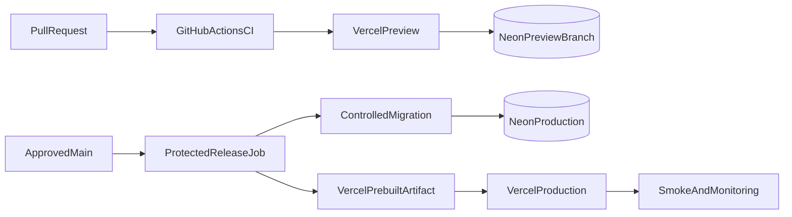

# Fitara Work deployment plan

- Status: Proposed
- Application: Vercel Next.js Node runtime
- Database: Neon PostgreSQL
- CI/release: GitHub Actions

## 1. Environment topology

### Local

- Developer-specific Neon branch/database or local PostgreSQL.
- GitHub OAuth development app/callback.
- `.env.local`, never committed.
- Idempotent demonstration seed.

### CI

- Disposable PostgreSQL service or ephemeral Neon branch.
- Auth fixtures; no production OAuth credentials.
- Destroyed after run.

### Preview

- Vercel preview per pull request.
- Isolated Neon preview branch when supported.
- Separate preview OAuth app or stable staging callback; arbitrary preview callbacks must not weaken redirect validation.
- No production data or production GitHub installation.
- Automatic branch/database cleanup.

### Staging

- Stable Vercel URL and isolated Neon database.
- OAuth configuration matching production behavior.
- Production-like migrations, smoke, accessibility, and release rehearsal.

### Production

- Dedicated Vercel project/environment and custom domain.
- Dedicated Neon production branch/project and least-privilege roles.
- Dedicated GitHub OAuth application.
- TLS, monitoring, PITR/backups, incident ownership, and restricted release approvals.



## 2. Environment variables

Document placeholders in `.env.example`; update `.gitignore` so `.env.example` is committed.

Required:

```text
DATABASE_URL
DATABASE_URL_UNPOOLED
BETTER_AUTH_SECRET
BETTER_AUTH_URL
GITHUB_CLIENT_ID
GITHUB_CLIENT_SECRET
NEXT_PUBLIC_APP_URL
LOG_LEVEL
```

Optional after provider decisions:

```text
ERROR_REPORTING_DSN
OTEL_EXPORTER_OTLP_ENDPOINT
RATE_LIMIT_STORE_URL
RATE_LIMIT_STORE_TOKEN
E2E_DATABASE_URL
E2E_BASE_URL
VERCEL_TOKEN
VERCEL_ORG_ID
VERCEL_PROJECT_ID
```

Future GitHub App values are not introduced before that phase:

```text
GITHUB_APP_ID
GITHUB_APP_PRIVATE_KEY
GITHUB_WEBHOOK_SECRET
GITHUB_APP_CLIENT_ID
GITHUB_APP_CLIENT_SECRET
```

Rules:

- Parse server values in `lib/env.ts` at startup/build where appropriate.
- Only validated `NEXT_PUBLIC_*` values enter client bundles.
- Separate credentials per environment.
- Use Vercel/GitHub environment secret stores, not repository values.
- Rotate after suspected exposure and on an approved schedule.
- Never print secrets in build/migration/smoke logs.

## 3. Connection management

- `DATABASE_URL` is the Neon pooled TLS runtime URL, used by `drizzle-orm/node-postgres` with `pg` in the Node.js runtime. This checked-out connection supports required interactive transactions; HTTP-style queries are not an assumed substitute.
- `DATABASE_URL_UNPOOLED` is restricted to migration/administrative jobs.
- Create the Drizzle client once per runtime module, not for every query.
- Keep transactions short and avoid waiting on external APIs while holding them.
- Monitor active connections, queueing, query duration, and function concurrency.
- Use Node runtime for database/auth routes unless edge compatibility is explicitly proven.
- Local development and automated integration tests use distinct PostgreSQL URLs/databases; neither may equal preview or production.

## 4. Migration workflow

1. Modify Drizzle schema.
2. Generate SQL migration locally.
3. Review SQL for locks, rewrites, data loss, defaults, backfills, and indexes.
4. Run migration from empty database.
5. Run migration from previous released schema.
6. Run integration tests and representative query plans.
7. Commit schema and generated SQL together.
8. Apply once through protected production release job.

Policies:

- Never use `drizzle-kit push` in shared/production environments.
- Never migrate on application startup or Vercel build.
- Use expand → backfill → switch → contract across releases.
- Add large constraints/indexes using PostgreSQL-safe staged/concurrent approaches where applicable.
- Record release and migration IDs.
- Use forward corrective migrations, not destructive down migrations.

## 5. Seed strategy

- `npm run db:seed` is idempotent and local/preview only by default.
- Local seed contains realistic roles/projects/tickets/relationships/history.
- Production bootstrap seeds only required status/type/workflow definitions.
- Never seed demo users, sessions, projects, or tickets in production.
- First production owner/bootstrap is an explicit, audited operation.

## 6. CI workflow

Proposed files:

```text
.github/workflows/ci.yml
.github/workflows/preview.yml
.github/workflows/release.yml
.github/dependabot.yml
```

Required pull-request checks:

1. `npm ci`.
2. Lockfile integrity.
3. format, ESLint, TypeScript.
4. unit/component coverage.
5. disposable PostgreSQL migration and integration tests.
6. Next.js production build.
7. Chromium Playwright against production server.
8. Migration/schema drift.

Branch protection requires current checks, review, resolved conversations, and restricted production environment approval.

## 7. Preview deployment

- Vercel may deploy previews automatically after safe checks.
- Preview receives only preview-scoped secrets.
- Apply migrations only to the preview database.
- If isolated preview databases are unavailable, disable stateful preview behavior rather than connect production.
- Protect previews that contain realistic/internal data.
- Expire preview databases and secrets with the pull request.
- Use a stable staging environment for full OAuth E2E if GitHub callback registration cannot safely support arbitrary preview URLs.

## 8. Production release order

Recommended authority: GitHub Actions orchestrates production; Vercel remains preview host. Disable racing automatic production deployment from `main`.

1. Approve protected release.
2. `npm ci` and full CI.
3. Pull production Vercel configuration.
4. Build immutable prebuilt artifact.
5. Confirm backward compatibility and backup state.
6. Apply reviewed migration once.
7. Deploy artifact.
8. Run smoke tests.
9. Observe error, latency, auth, and database signals.
10. Record release/migration/deployment IDs.

Representative target commands:

```bash
npm ci
npm run ci
npx vercel pull --yes --environment=production
npx vercel build --prod
npm run db:migrate
npx vercel deploy --prebuilt --prod
npm run smoke -- "$PRODUCTION_URL"
```

This authority/order remains a product/operations approval item.

## 9. Health and smoke checks

`/api/health`:

- Liveness without database dependency.
- Optional separate readiness with a bounded simple database check.
- Generic result only; no SQL, connection details, secret state, or detailed dependency versions.

Post-deploy smoke:

- Public/sign-in page.
- Anonymous protected redirect.
- Auth callback route availability.
- Controlled smoke identity can read its workspace.
- Representative project/ticket read.
- No error/latency/auth/connection spike.
- No write smoke against real production records unless a dedicated synthetic workspace and cleanup policy are approved.

## 10. Observability and logging

Minimum:

- Structured JSON logs.
- Request/correlation ID.
- Route template, method, status, duration.
- Safe user/workspace/project identifiers where needed.
- Release/deployment/migration IDs.
- Auth failure categories.
- Invitation failures.
- Database duration/error/connection metrics.
- Mutation conflict and rate-limit counts.
- Unexpected exception reporting with source maps.

Redact:

- Cookies and authorization headers.
- OAuth/session/invitation/webhook tokens.
- Database URLs.
- Ticket descriptions/comments and raw request bodies.
- GitHub private keys and provider payload secrets.

Alert candidates:

- Elevated 5xx.
- Repeated OAuth/callback failures.
- Database saturation/latency.
- Migration/smoke failure.
- Unusual authorization denials or cross-workspace probes.
- Notification/outbox backlog later.

Every alert needs threshold, severity, owner, and runbook.

## 11. Backups and recovery

- Enable Neon PITR according to the selected plan and verify actual retention.
- Define RPO/RTO with the product owner/operations.
- Consider encrypted independent logical exports if compliance/RPO requires them.
- Run quarterly restore drills and before major schema changes.
- Restore into an isolated database.
- Verify migration level, row counts, constraints, application startup, auth, and representative reads.
- Record restore duration and evidence.
- Restrict who may initiate production restoration.

## 12. Rollback

### Application

- Promote the last known-good immutable Vercel deployment.
- Keep the previous app release compatible with the expanded schema.
- Repeat smoke/monitoring after promotion.

### Database

- Stop affected writes.
- Prefer a forward corrective migration.
- Use PITR/restore only for confirmed data-integrity need under incident authority.
- Never automatically reverse a migration that may discard data.

### Feature containment

Design kill switches/operational controls for later high-risk integrations, automation, notification processing, and drag mutations. Read/manual ticket work should remain available when safe.

## 13. Security and secret management

- Least-privilege Vercel, Neon, GitHub, and release identities.
- Production environment approval and restricted secret access.
- Separate OAuth apps and redirect allowlists.
- Dependabot/dependency review with human vulnerability triage.
- Secure headers/CSP validated in staging.
- Preview/CI principals cannot reach production DB.
- No production data copied into preview/test.
- Audit administrative/release/migration access.

## 14. Backup and migration failure scenarios

- Migration fails before deploy: stop release; app remains previous version.
- Migration succeeds/deploy fails: schema must remain backward compatible; promote prior app and prepare forward fix.
- OAuth provider outage: existing valid sessions continue where policy allows; show safe sign-in outage state.
- Neon saturation: shed expensive requests, investigate pool/query metrics, preserve read paths where possible.
- Suspected workspace leak: contain writes/access, preserve evidence, rotate secrets if relevant, assess affected workspaces, invoke incident plan.

## 15. Production readiness checklist

- All required CI checks green.
- ADRs accepted and owner decisions recorded.
- Domain/TLS and OAuth callbacks verified.
- Production secrets/roles least privilege.
- Migration rehearsed with production-like data.
- Backup/PITR and isolated restore drill verified.
- Smoke and application rollback exercised.
- Monitoring/alerts/runbooks active.
- Privacy, retention, incident, support, and release owners named.
- No preview/CI access to production.
- Seed contains no demo data.
- Accessibility/security reviews complete.

## 16. Decisions requiring owner input

- Vercel team/project and production deployment authority.
- Neon region/plan, preview branching, PITR retention.
- RPO, RTO, retention, and restore authority.
- Stable staging/preview OAuth approach.
- Error reporting and telemetry provider.
- Domain and incident/support contacts.
- Production workspace/owner bootstrap.
- Feature kill-switch mechanism.

Recommended defaults pending approval: paid Neon capability with PITR, Vercel and Neon in the same supported region, 15-minute RPO, four-hour RTO, optional staging, structured Vercel logs plus a selected error provider, and named owner-designated production releasers. Preview databases are isolated branches with preview-only variables, migrations, synthetic seeds, expiry/cleanup, and no production OAuth secrets; untrusted fork previews disable auth or use non-sensitive test credentials. Preview builds never migrate production.
