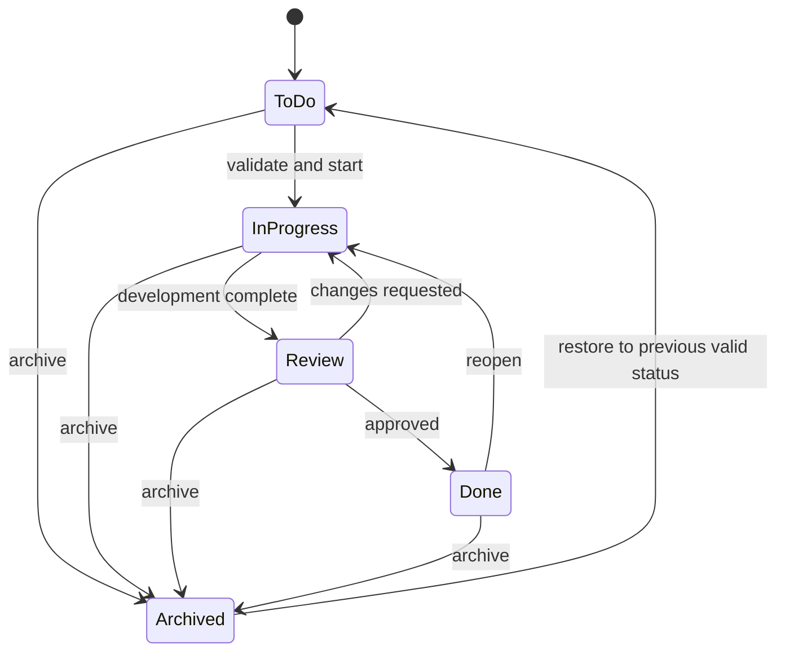

# Fitara Work product specification

- Status: Proposed
- Audience: Product, engineering, design, QA, operations
- Product principle: **Simple by default, powerful when expanded**
- Initial users: Fitara developers and product lead

## 1. Product summary

Fitara Work is an internal ticketing and project-management application. It combines fast keyboard-first work management, clean ticket pages, structured development workflows, disciplined triage, explicit relationships, durable audit history, and a future connection to development activity.

The first release is a responsive web application in this Next.js repository. It is not a generic dashboard and does not attempt to reproduce every Jira or ServiceNow capability.

## 2. Repository baseline

The repository is a nearly untouched `create-next-app` scaffold:

- Next.js 16.3.6 App Router and React 19.2.8.
- TypeScript 5.9.3 with `strict: true`, although `allowJs` is still enabled.
- Tailwind CSS 4.3.3 through `@tailwindcss/postcss`.
- ESLint 9 with Next.js Core Web Vitals and TypeScript rules.
- npm 10.9.4 and a retained `package-lock.json`.
- Root-level `app/` with only `layout.tsx`, `page.tsx`, and `globals.css`.
- Default Next.js assets and README.
- Empty `next.config.ts`.
- No database, ORM, authentication, validation, test, formatter, component, logging, or observability dependencies.
- Existing `npm run lint` passes.
- Git branch `main` has no commits, tracks a missing `origin/main`, and all scaffold files are untracked. This work must not reset or overwrite that state.

## 3. Product goals

1. Capture a ticket with minimal friction.
2. Make triage, ownership, priority, and next action obvious.
3. Give contributors fast board and list workflows.
4. Preserve context in a structured ticket detail experience.
5. Record every meaningful mutation in immutable history.
6. Keep archived work searchable and auditable.
7. Enforce workspace authorization on the server.
8. Leave stable boundaries for future mobile clients, GitHub integration, external intake, and automations.

### Initial success criteria

- An invited user can sign in with GitHub and reach a workspace.
- A member can create a ticket in under 30 seconds.
- Common board actions provide immediate feedback and recover cleanly from failure.
- Core flows are usable with keyboard, screen reader, and at 200% zoom.
- No workspace resource can be read or changed without an active membership check.
- The critical Playwright paths pass against a production build.

## 4. Personas

### Product lead

Creates projects, triages incoming work, establishes priority, assigns owners, reviews progress, and needs cross-project visibility.

### Developer

Finds assigned work, changes status, records acceptance criteria, creates subtasks, adds comments, identifies blockers, and needs keyboard-efficient interaction.

### Workspace administrator

Manages membership and roles, project archive/restore lifecycle, and workspace controls. Purge is not an ordinary MVP operation.

### Viewer

Reads active and archived work, searches, filters, and follows progress without changing shared domain data.

## 5. Assumptions

- GitHub OAuth is the MVP identity provider.
- Access is invitation/allowlist based; public signup is disabled.
- A user may belong to more than one workspace, although the first seed may contain one Fitara workspace.
- Workspace roles are Owner, Admin, Member, and Viewer.
- All workspace members can see all projects in MVP. Private projects and project-specific roles are later work.
- Each ticket has one assignee in the MVP user experience.
- Ticket descriptions and comments use Markdown source rendered through a sanitizer.
- Time is stored in UTC and displayed in the user's local timezone.
- Realtime sockets are unnecessary for MVP; focus refresh and targeted polling are sufficient.
- Ordinary removal means archival, not hard deletion.

## 6. MVP scope

### Identity and workspaces

- Invite-only GitHub OAuth.
- Database-backed sessions and secure sign-out.
- Administratively bootstrapped initial workspace and owner; public/self-service workspace creation is disabled.
- Workspace membership and Owner, Admin, Member, Viewer roles.
- Membership suspension and role changes with last-owner protection.

### Projects and personal navigation

- Create and edit a project.
- Archive and restore a project.
- No routine hard deletion; a future controlled purge process is explicitly out of scope.
- Pin projects and saved views.
- Remove and reorder pins.
- Restore any still-available project or saved view to the sidebar.

### Tickets

- Create, read, edit, archive, and restore tickets.
- Types: Bug, Feature, Task, Improvement.
- Priorities: P1, P2, P3, P4.
- Statuses: To Do, In Progress, Review, Done.
- One assignee, one reporter, labels, optional due date.
- Acceptance criteria.
- Parent tickets and subtasks.
- Blocking, blocked-by, related, and duplicate relationships.
- Comments and immutable activity history.
- Board and list views.
- Search and status, priority, project, label, and assignee filters.
- “Only mine” filtering.
- Dragging and keyboard-moving tickets between statuses.
- Side drawer that preserves board/list context.
- Canonical full-page ticket route for direct links and mobile.

### Experience quality

- Loading, empty, error, conflict, offline/network, archived, not-found, and permission-denied states.
- Responsive desktop and usable mobile layouts.
- Light, dark, and system themes.
- Seeded demonstration data.
- Priority and status communicated with text/iconography, never color alone.

## 7. Explicit non-goals

- External customer submission portal.
- Email-to-ticket intake.
- SLAs, escalations, on-call, or service catalogs.
- Public signup or password authentication.
- Private projects and custom project roles.
- Fully custom workflows in the MVP UI, despite a schema that can support them later.
- Attachments in MVP.
- GitHub repository activity in MVP.
- Realtime multiplayer, presence, or WebSockets.
- AI features.
- Native mobile applications.
- Offline-first editing.
- Time tracking, billing, advanced reporting, or sprint analytics.
- User-authored automation rules.
- Microservices or a separate backend service.

## 8. Navigation model

The application shell has a left sidebar:

1. Product workspace / workspace switcher.
2. My work.
3. To Do inbox.
4. Active work.
5. Pinned work.
6. User profile and workspace controls.

Pinned Work is personal and ordered. A pin references a project or saved view. Removing a pin changes only the current user's navigation.

### Three distinct operations

- **Remove from sidebar:** deletes only the user's pin. Project, tickets, and history are unchanged.
- **Archive project:** hides the project from active navigation and ordinary active queries while retaining all data. It can be restored.
- **Delete project:** owner-only exceptional operation, requires exact project-key confirmation and is rejected when retained tickets, history, integrations, or references exist.

## 9. Core ticket lifecycle



The product does not forbid moving directly between nonadjacent statuses, but the service records the transition and authorization policy may tighten this later. Every successful status change increments the ticket version and writes an activity event in the same database transaction.

## 10. Primary user journeys

### Accept an invitation

1. An owner or admin invites an approved email.
2. The recipient opens the invitation URL and continues with GitHub.
3. Fitara Work verifies invitation state and matches any verified GitHub email to the normalized invitation email.
4. Better Auth creates or links the identity.
5. Membership creation, invitation consumption, and session establishment complete idempotently.
6. The user enters the requested workspace.

Failure variants include expired, revoked, consumed, mismatched email, OAuth cancellation, unavailable provider, and database failure. An uninvited OAuth callback must never create active workspace access.

### Create and triage a ticket

1. A member selects New Ticket from the shell, board, list, or keyboard shortcut.
2. The form requires title and project and defaults type to Task, priority to P3, and status to To Do.
3. The server allocates the next project-local sequence, creates the ticket and initial activity event transactionally, and returns the canonical DTO.
4. The user optionally sets type, priority, labels, assignee, due date, criteria, parent, or blockers.
5. To Do intake validates, prioritizes, labels, and assigns the ticket.

### Move a ticket

1. The user drags a card or invokes its Move menu/keyboard controls.
2. The board updates optimistically and announces the destination.
3. The request includes target status, neighboring ticket IDs, and expected version.
4. The service authorizes, calculates rank, performs a conditional update, and appends activity transactionally.
5. Success reconciles server data; failure restores the snapshot.
6. A `409` shows the current server version and an explicit retry path.

### Open and edit ticket detail

1. Selecting a card updates the URL and opens a side drawer without losing board position or filters.
2. The drawer loads full details, relationships, criteria, comments, and activity.
3. Direct navigation uses the full-page ticket route.
4. Closing the drawer restores focus to the originating card and preserves scroll/filter state.

### Manage pinned work

1. A user pins a project or saved view.
2. The pin appears in the user's sidebar.
3. Reordering is optimistic and persists an ordered rank.
4. Removing the pin does not mutate the target.
5. An available target can be pinned again later.

### Archive and restore a project

1. Owner/admin confirms archival.
2. The project disappears from active work and ordinary ticket creation is rejected.
3. Existing links remain readable to authorized users and clearly show archived state.
4. Restore returns the project to active navigation without restoring individually archived tickets.

## 11. Route map

```text
/
/sign-in
/invite/[token]
/auth/error
/w/[workspaceSlug]/my-work
/w/[workspaceSlug]/triage
/w/[workspaceSlug]/active
/w/[workspaceSlug]/projects
/w/[workspaceSlug]/projects/new
/w/[workspaceSlug]/projects/[projectKey]
/w/[workspaceSlug]/projects/[projectKey]/tickets
/w/[workspaceSlug]/tickets/[ticketIdentifier]
/w/[workspaceSlug]/settings/profile
/w/[workspaceSlug]/settings/members
/w/[workspaceSlug]/settings/projects
/w/[workspaceSlug]/settings/workspace
```

The project route uses `view=board|list` and filter query parameters. `ticket=FIT-153` opens the route-intercepted drawer while `/w/.../tickets/FIT-153` remains the canonical full-page fallback.

## 12. Screen inventory

### Authentication

- Sign in: GitHub action, invite-only explanation, provider/loading/error states.
- Invitation: role/workspace summary, expiry, OAuth continuation, invalid variants.
- Access denied: reason-safe message, switch account, sign out.

### Application shell

- Workspace switcher.
- Core navigation and customizable pins.
- Search/command entry point.
- Profile menu, theme selection, sign out.
- Mobile sidebar sheet.

### Primary workspace

- Breadcrumb and project/workspace title.
- New Ticket action.
- Board/List switcher.
- Search, priority, status, project, label, assignee, “Only mine.”
- Result count.
- Ticket board or table.
- Filter state in the URL.

### Ticket card

- Identifier and title.
- Type, priority, labels.
- Assignee.
- Blocked state with text/icon.
- Comment count.
- Optional due date.

No description preview, reporter, timestamps, or decorative metrics appear by default.

### Ticket drawer/page

- Identifier, type, title, description.
- Status, priority, assignee, reporter, project, labels, due date.
- Acceptance criteria.
- Parent and subtasks.
- Blocking and blocked-by relationships.
- Attachment placeholder for later phase.
- Comments and activity history.
- GitHub development placeholder only after that integration is implemented.

### Administration

- Member/role/invitation management.
- Project list with active/archived tabs and archive/restore guardrails.
- Workspace identity and ownership controls.

## 13. Interaction and state requirements

### Loading

- Preserve the shell and previous results during refresh.
- Use content-shaped skeletons for first loads.
- Stream independent regions behind `Suspense` where useful.

### Empty

Distinguish no projects, no tickets, empty status, no assigned work, no pins, no search results, and no archived results. Offer only actions the actor may perform.

### Failure

- Preserve form text and optimistic snapshots.
- Return safe messages and request IDs.
- Offer retry only when safe.
- Never render SQL, stack traces, OAuth details, or secrets.

### Conflict

- Do not overwrite a newer version.
- Reconcile to authoritative data and preserve the user's intended input.
- Explain which record changed and offer retry/reapply.

### Permission denied

- Pages show a dedicated state.
- APIs use `401` for no session, `403` for a known disallowed capability, and generally `404` for an inaccessible cross-workspace resource.

### Network unavailable

The app is not offline-first. An unconfirmed mutation is visibly pending, then rolled back or offered for retry. It is never presented as durable.

## 14. Accessibility

Target WCAG 2.2 AA:

- Semantic landmarks, headings, lists, tables, buttons, and form labels.
- Visible focus and logical tab order.
- Accessible names for icon-only controls.
- Field errors associated with inputs and summarized when appropriate.
- Drawer/dialog focus trap, initial focus, Escape behavior, and focus restoration.
- Pointer, keyboard drag, and non-drag move controls with equivalent results.
- Live-region announcements for move, success, rollback, and conflict.
- Reduced-motion support.
- Text/icon indicators in addition to color.
- AA contrast in both themes.
- Touch targets usable on mobile.
- Keyboard shortcuts discoverable and disabled in editable fields.

## 15. Product-level security requirements

- Authentication, membership, capability, and resource-scope checks occur server-side for every read and mutation.
- Client-supplied workspace, actor, reporter, author, role, sequence, rank, and audit fields are ignored/rejected.
- All untrusted values are parsed with strict Zod schemas.
- Markdown rendering is sanitized; arbitrary HTML is not supported in MVP.
- Session cookies are `HttpOnly`, `Secure` in production, and appropriately `SameSite`.
- Cookie-authenticated mutations verify origin/CSRF protections.
- Auth, invitation, destructive, and high-volume routes are rate-limited.
- Logs redact cookies, tokens, authorization headers, invitation tokens, ticket descriptions, and comments.
- Attachments later use private object storage, signed URLs, MIME/size checks, checksums, and malware scanning.

## 16. Seeded demonstration data

Local seed data should be idempotent and include:

- One Fitara workspace.
- Owner, admin, member, and viewer fixture identities.
- Two active projects and one archived project.
- The four statuses, four ticket types, and representative labels.
- Tickets in every status and priority.
- Assigned/unassigned, blocked, parent/subtask, due/overdue, and archived examples.
- Acceptance criteria, comments, activity, saved views, and pins.

Production seed must create only required system definitions, never demo users or tickets.

## 17. Product-owner decisions and recommended MVP defaults

| Decision | Recommended MVP default | Consequence / unresolved input |
|---|---|---|
| Admission | Exact match to any verified GitHub email; no org-membership admission | Private/unverified email cannot accept; owner may later approve both methods. |
| Session | 12-hour absolute, 30-minute rolling idle, 15-minute recent-auth requirement for destructive administration | Balances revocation and usability; owner may shorten. |
| Member assignment | Self-claim unassigned work and self-unassign only | Admin/owner assigns peers. |
| Comment editing | Author for 15 minutes; owner/admin moderation; tombstones and revision evidence | Retains auditability. |
| Project visibility | All active workspace members; no `ProjectMembership` | Restricted projects require a later authorization redesign. |
| Project archive authority | Owner/admin only | Members request archival out of band. |
| Notifications | In-app for assignment, mention, blocking, and comments on assigned/reported tickets | No email/push; final mention syntax needs UX confirmation. |
| Initial owner | One-time audited administrative bootstrap by normalized verified email | No public workspace creation. |
| Retention | Preserve archived domain/audit data; no purge until a written schedule is approved | Legal/business retention period remains unresolved. |
| Recovery | Target RPO 15 minutes and RTO 4 hours | Must be confirmed against the selected Neon plan and drill results. |
| Neon | Paid plan supporting PITR; colocate region with Vercel | Exact plan and region remain owner choices. |
| Staging | Optional before first release; required only if owner wants a promotion gate | Preview remains isolated regardless. |
| Observability | Structured Vercel logs plus a selected error-monitoring provider | Provider and retention remain unresolved. |
| Release authority | Named owner-designated maintainers approve production | Names and branch protection remain unresolved. |
| Member ticket archival | Admin/owner only | Can be relaxed later for own-reported tickets. |

## 18. MVP release criteria

- Invite-only GitHub authentication and session expiry work in staging and production.
- Authorization matrix tests cover every mutation and role.
- Ticket identifiers are unique under concurrent creation.
- Activity creation is atomic with meaningful mutations and cannot be updated/deleted by the app role.
- Board/list, drawer/full-page detail, search/filters, comments, criteria, hierarchy, and blocking relations pass critical E2E paths.
- Loading, empty, error, conflict, archived, and permission states are implemented.
- Keyboard-only board use passes manual and automated checks.
- Production migration, backup restore, smoke test, rollback, and incident runbooks are rehearsed.
