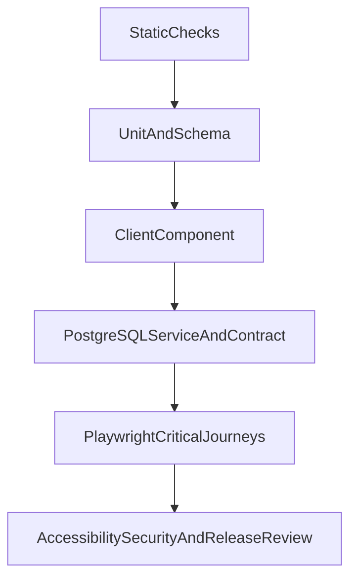

# Fitara Work testing strategy

- Status: Proposed
- Principle: Test behavior at the cheapest layer that proves it

## 1. Goals

- Prevent cross-workspace disclosure and privilege escalation.
- Prove database constraints, migrations, transactionality, and concurrency.
- Protect authentication, project, ticket, board, collaboration, and archival paths.
- Verify optimistic rollback and reconciliation.
- Meet WCAG 2.2 AA on critical workflows.
- Catch deployment/migration failures before production.
- Favor deterministic behavior assertions over implementation snapshots.

## 2. Testing pyramid



Most cases belong in unit/integration layers. E2E covers high-value boundaries rather than every field combination.

## 3. Static checks

Run on every pull request:

- Prettier format check.
- ESLint Core Web Vitals/TypeScript rules.
- `tsc --noEmit`.
- Drizzle migration/schema drift check.
- Next.js production build.
- Dependency/lockfile integrity.

Next.js 16 no longer runs lint automatically during build, so lint is a separate required check.

## 4. Unit tests with Vitest

Targets:

- Zod normalization/limits/error mapping.
- Environment validation.
- Project key and identifier formatting.
- Capability/role policy.
- Invitation eligibility.
- Ticket sequence service behavior with repository fakes.
- Fixed-width numeric-gap rank and rebalance algorithm.
- Parent and blocking cycle detection.
- Cursor encode/decode and filter parser.
- Activity change allowlists.
- DTO mapping and secret exclusion.
- Idempotency body hashing.
- Problem response mapping.

Tests inject clock, random/ID generators, and repositories. Avoid broad snapshots and Tailwind class assertions.

## 5. Client Component tests

Use React Testing Library and user-event for:

- Project/ticket/comment forms and associated field errors.
- Pending, disabled, retry, and conflict behavior.
- Filter URL state.
- Drawer focus trap/restoration and Escape behavior.
- Board keyboard movement and live announcements.
- Non-drag move controls.
- Optimistic ticket/pin/comment success and rollback.
- Theme behavior and reduced-motion branches.
- Role-based control visibility as UX only.

Create a fresh QueryClient per test with retries disabled. Mock the HTTP boundary, not internal component implementation.

The installed Next.js guidance notes Vitest limitations for async Server Components; exercise those routes through integration/E2E instead of brittle direct rendering.

## 6. PostgreSQL/service integration tests

Run real migrations against a disposable PostgreSQL database/Neon branch.

Required targets:

- Empty-database migration.
- Migration from previous released schema.
- Idempotent local seed.
- Auth/domain foreign-key type compatibility.
- Composite workspace constraints.
- Repository scope on every domain.
- Concurrent per-project ticket sequence allocation.
- Versioned conditional updates and `409`.
- Numeric-gap rank collision/rebalance/concurrent moves.
- Ticket/activity same-transaction commit and rollback.
- Activity update/delete rejection.
- Last-owner locking.
- Invitation callback idempotency.
- Cross-workspace status/type/label/assignee/parent/relation rejection.
- Parent and blocking cycle prevention.
- Stable cursor pagination without duplicates/skips.
- Search/filter query plans on representative volume.
- Archive/restore/deletion guards.

Use unique workspace IDs and isolated databases/schemas. Transaction rollback per test is useful only when the code under test does not manage its own independent transaction. Never point tests at shared development or production.

Preferred local execution uses an isolated PostgreSQL container per suite/worker. Developers without Docker use a disposable Neon test branch or explicitly named test instance with per-run schema isolation. A startup guard parses host/database identity and refuses production, preview, or any URL not explicitly marked as test.

## 7. Route and contract tests

Call Route Handlers or a thin test adapter with real validation/services/database:

- Success status/body/headers.
- Problem Details shape and stable code.
- Invalid JSON, content type, body size, query, and cursor.
- Missing session, suspended membership, wrong role, cross-workspace ID.
- `If-Match`, ETag, idempotency replay/mismatch.
- Origin/CSRF behavior.
- Rate-limit headers and `Retry-After`.
- `Cache-Control: private, no-store`.
- DTO excludes OAuth/session/audit/internal fields.

Repeat shared service authorization tests for Server Action adapters to ensure no alternate entry point bypasses policy.

## 8. Authorization test matrix

Generate parameterized tests from `docs/authorization-matrix.md`:

- Every role × every mutation.
- Self versus other actor conditions.
- Active versus suspended membership.
- Active versus archived project/ticket.
- Same versus different workspace.
- Current versus stale version.
- Owner count one versus multiple.

Security/tenant-isolation failures block release and cannot be quarantined.

## 9. End-to-end tests with Playwright

Run against `next build`/production server, not only dev.

Critical paths:

1. Anonymous user is redirected to sign-in.
2. Valid invitation/GitHub fixture establishes membership.
3. Invalid/expired/mismatched invitation is denied.
4. User cannot access another workspace by URL/API ID.
5. Owner/admin creates, edits, archives, and restores a project.
6. User pins, reorders, removes, and restores a pin without project mutation.
7. Member creates a ticket and receives expected identifier.
8. Ticket opens in drawer and direct full-page URL.
9. Edit, assignment, criteria, labels, archive/restore.
10. Board movement by pointer, keyboard, and menu persists after refresh.
11. Stale move/edit shows conflict and rolls back.
12. Filters/search/list/board URLs restore state.
13. Comment success/failure retry and activity timeline.
14. Parent/subtask and blocking relationship.
15. Viewer read-only behavior.
16. Loading, empty, error, permission, archived, and mobile states.
17. Light/dark/system themes and reduced motion.

Run Chromium on every PR. Run Firefox/WebKit nightly or release-gated unless CI time permits all browsers on each PR.

Do not call live GitHub in routine CI. Use Better Auth-compatible seeded sessions or a test-only auth fixture mechanism that is impossible to enable in production.

## 10. Accessibility testing

Automated:

- Semantic RTL queries.
- axe checks on core pages/drawer/forms.
- Playwright keyboard journeys.
- Focus and live-region assertions.
- Contrast checks where tooling is reliable.

Manual before MVP:

- Keyboard-only complete ticket lifecycle.
- VoiceOver + Safari and one additional screen-reader/browser pairing.
- 200% and 400% zoom/reflow.
- Mobile touch targets.
- Reduced motion.
- High contrast where platform support applies.
- No color-only status/priority/blocked communication.

Automated scans do not replace manual assistive-technology review.

## 11. Security test targets

- IDOR/cross-workspace IDs.
- Privilege escalation and alternate transport adapters.
- Mass assignment of workspace/role/actor/reporter/assignee/rank/version/audit.
- Stored/reflected XSS in Markdown, labels, names, and errors.
- CSRF/origin mismatch.
- OAuth callback/open redirect/state handling.
- Invitation token brute force, replay, expiry, and log leakage.
- Session fixation/revocation/suspension.
- Oversized/invalid content type and parser limits.
- SQL injection assumptions and raw-SQL parameterization.
- Rate-limit bypass basics.
- Activity tampering.
- Secret/client-bundle scan.

Use a dedicated security review before production in addition to ordinary tests.

## 12. Performance tests

- Seed representative small and upper-bound MVP workspaces.
- Capture `EXPLAIN (ANALYZE, BUFFERS)` for board, list, search, My Work, comments, and activity.
- Track p50/p95 server duration and database duration.
- Verify no N+1 label/assignee/count reads.
- Check board/list response size.
- Analyze client bundle and avoid pulling server libraries/client-wide providers.
- Define concrete latency/bundle budgets with product/operations before Phase 9.

No external load-testing infrastructure is required until expected concurrency is known, but sequence and move contention tests are mandatory.

## 13. Fixtures and seed

- Factories live under `tests/factories/`.
- Fixtures explicitly name workspace, role, state, and archival state.
- Use a fixed clock and unique suffixes.
- Local demo seed is not test setup.
- Never copy production data to lower environments.
- Failure artifacts redact tokens, cookies, invitation URLs, emails where unnecessary, comments, and descriptions.

## 14. Coverage

Initial suggested thresholds:

- Global 80% lines/statements/functions and 75% branches.
- Authorization, sequence allocation, ordering, activity, and validation use scenario completeness rather than only percentage.
- Exclude generated migrations/types and trivial configuration with documented reasons.
- Ratchet upward; do not add meaningless tests to satisfy numbers.

## 15. Local workflow

Target workflow after Phase 0/2:

```bash
cp .env.example .env.local
npm ci
npm run db:migrate
npm run db:seed
npm run dev

npm run format:check
npm run lint
npm run typecheck
npm run test
npm run test:run
npm run test:coverage
npm run test:integration
npm run test:e2e
npm run build
```

## 16. CI checks

Pull request pipeline:

1. `npm ci`.
2. format, lint, typecheck.
3. unit/component coverage.
4. start disposable PostgreSQL.
5. migrate from zero and run integration/contract tests.
6. build production application.
7. start production server and run Chromium E2E.
8. upload coverage, migration logs, traces, and screenshots on failure.

Nightly/release additions:

- Firefox/WebKit.
- Dependency/license review.
- Migration from previous release.
- Larger data/query-plan checks.
- Backup restore verification on schedule.

## 17. Flaky-test policy

- E2E may retry once in CI; a passing retry remains reported as flaky.
- Unit/integration do not retry unless testing an explicitly bounded retry algorithm.
- Quarantine requires issue, owner, reason, and expiry.
- No arbitrary sleeps; wait on observable UI/network/database state.
- Security, isolation, migration, and sequence tests cannot be quarantined for release.

## 18. Definition of done for a feature

A feature is incomplete until it has, at appropriate layers:

- Success and validation tests.
- Every applicable role and workspace scope.
- Loading, empty, failure, denied, conflict, and rollback behavior.
- Transaction/activity assertions for meaningful mutations.
- Keyboard/accessibility behavior.
- Migration/index/query evidence when persistence changes.
- Required CI checks passing.

Mandatory concurrency coverage includes simultaneous ticket allocation (unique and rollback-safe), move collision/rebalance, idempotent replay/hash mismatch, optimistic conflict, invitation acceptance, and two simultaneous last-owner mutations. Session cases cover account and membership suspension/removal revoking otherwise-valid sessions. Migration tests apply from empty and from the prior release and rehearse forward-fix recovery without SQLite.
